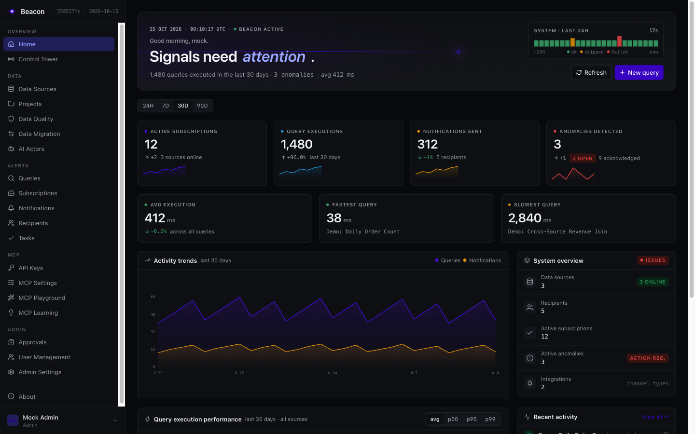
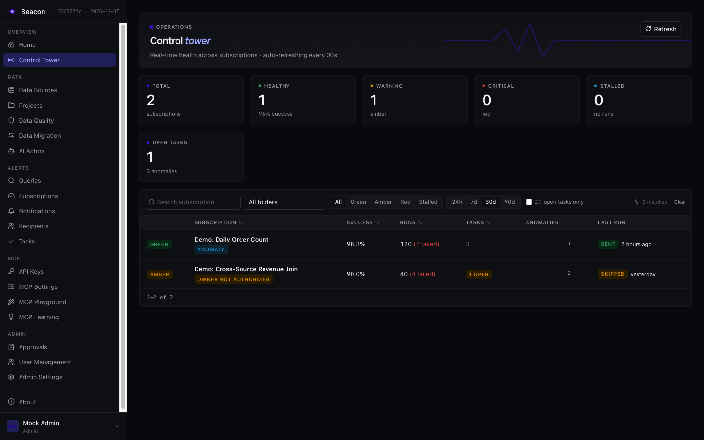
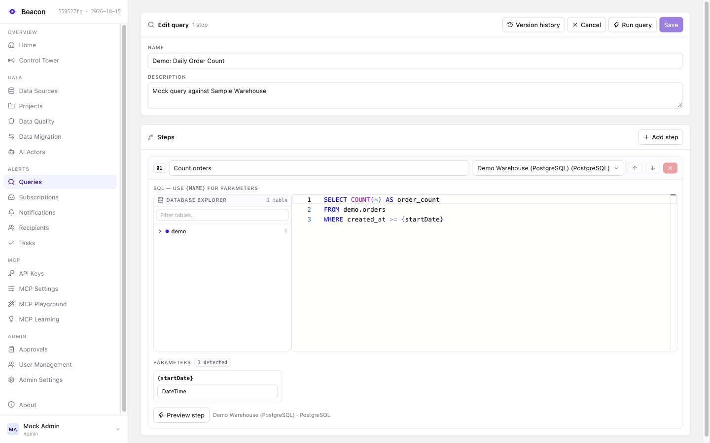
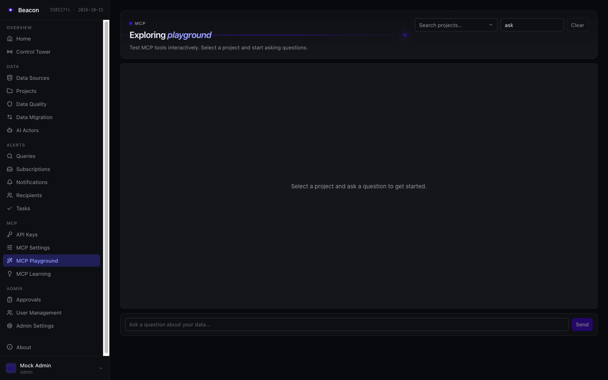
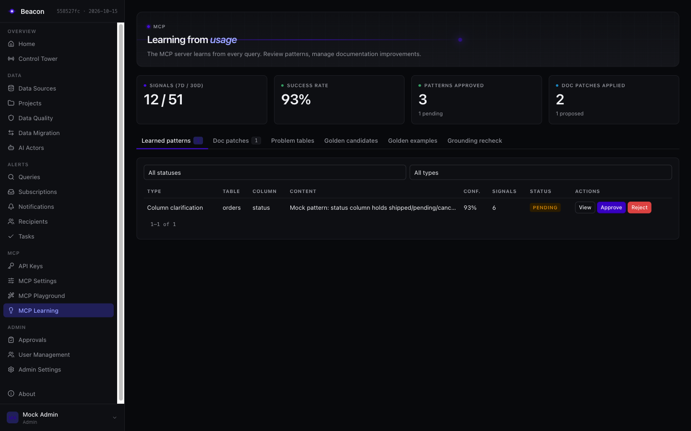
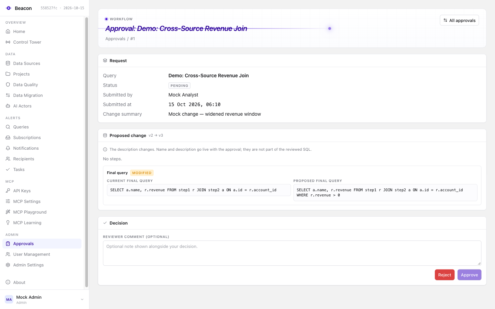
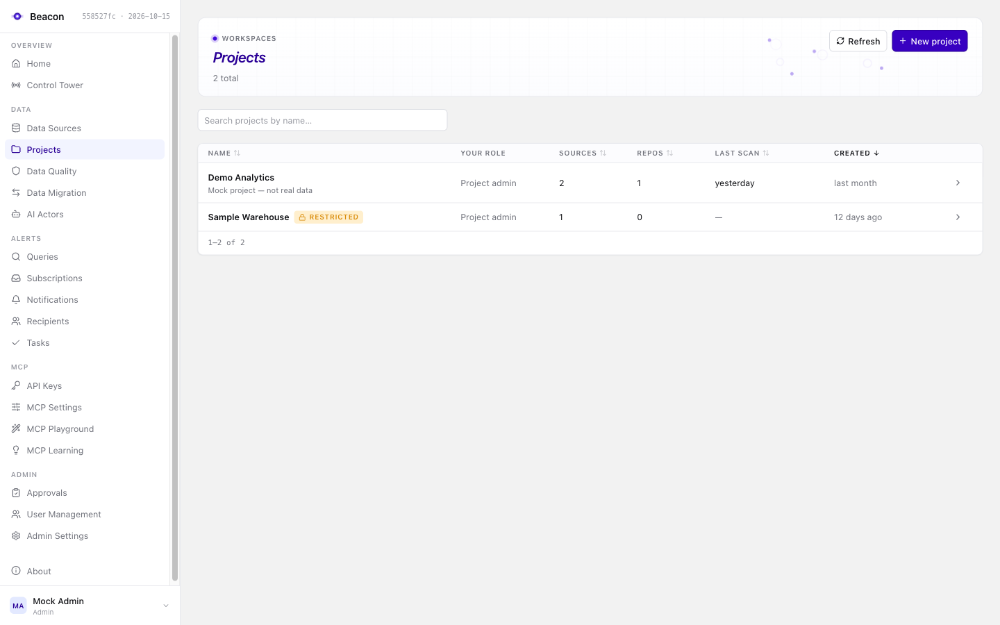

<div align="center">


# Beacon

**Database monitoring and governed AI access for .NET.**

Scheduled SQL checks, alerting and data movement, with an MCP server that gives AI assistants
project-scoped, read-only, masked and audited access to your data.

[](https://moberghr.github.io/beacon)
[](https://www.nuget.org/packages/Moberg.Beacon.Core)
[](https://dotnet.microsoft.com/)
[](https://moberghr.github.io/beacon/features/mcp-server/)
[](LICENSING.md)

[Documentation](https://moberghr.github.io/beacon) ·
[Integrate](https://moberghr.github.io/beacon/integrate/) ·
[Quick start](https://moberghr.github.io/beacon/getting-started/quick-start/) ·
[Security model](https://moberghr.github.io/beacon/features/security-model/) ·
[MCP server](https://moberghr.github.io/beacon/features/mcp-server/)

<br/>



<sub>Sample data from Beacon's mock mode (<code>npm run dev:mock</code>).</sub>

</div>

---

## Overview

Beacon is an operations layer for your databases, your team and your AI assistants. It connects to PostgreSQL, SQL Server, MySQL, Azure Synapse, Snowflake, BigQuery, Databricks, CloudWatch and REST APIs, and provides the following capabilities.

- **Monitoring:** multi-step SQL checks run on a cron schedule. Steps can span engines and are joined in memory.
- **Alerting:** results are delivered by email, Microsoft Teams, Slack, Jira or webhook. Tasks are opened when a check fails and resolved when it passes, and statistical anomalies are flagged.
- **AI access:** a Model Context Protocol (MCP) server lets Claude, Cursor, VS Code and other MCP clients explore and query your data through a single governed path.
- **Data movement:** when enabled, audited Insert, Upsert and Truncate-Load jobs write into data sources that an Admin has designated as write targets.

Beacon runs as a self-hosted reference application or inside your own ASP.NET Core application through the `Moberg.Beacon.*` NuGet packages, using your sign-in, job runner and deployment.

## Security and governance

Every SQL statement that Beacon runs, whether from an MCP tool, a scheduled check, a preview or an AI feature, passes through a **single execution gate**:

```
 question or SQL
       │
       ▼
 caller ───────────── API key, Entra caller or session · Execute scope · acting as its owner
       │
 project access ───── one evaluator · restricted projects answer 404 · data sources follow their projects
       │
 grounding ────────── M-Schema with join paths, glossary and verified examples (schema, not rows)
       │
 SQL gate ─────────── deployment locks · length · characters · guardrail · dialect AST validator
       │              · cross-database rule · system catalog rule · host policy · row cap written into the SQL
       ▼
 execution ────────── READ ONLY transaction on PostgreSQL and MySQL · statement timeout · read-only login
       │
 masking ──────────── PII masked fail-closed · database errors redacted
       │
 audit ───────────── every MCP call and the statements it ran, refusals included
                     · signed, append-only security audit trail · security log events
```

| | |
|---|---|
| **Projects define access** | New projects are restricted, and users outside a project receive a 404 response. API keys are limited to named projects. Scheduled work runs as its owner and is re-checked before every run. |
| **Separation of duties** | Approver, Auditor, SecurityAdmin, UserAdmin, DataSourceAdmin and MigrationOperator divide the Admin role. None of these permissions grants access to project data. |
| **Four-eyes approvals** | When enabled, changes to queries, migration jobs, Custom SQL rules and notification destinations take effect only after a second person approves the exact content. |
| **Deployment locks** | Read-only execution and PII detection are enforced by host configuration and apply to Admins as well. Sending row data to the LLM can be disabled the same way, and retaining query content in the MCP audit can be pinned off or on. |
| **Signed audit trail** | Sign-ins and changes to users, roles, keys, project access, data sources, delivery, settings and approvals are recorded as append-only events, each signed and verified on a schedule. An Auditor reads and verifies them, and each event is copied to the log stream for your SIEM. |
| **Protected secrets** | Connection strings are encrypted with AES-256-GCM, API keys are stored as SHA-256 hashes and shown once, Data Protection keys are encrypted at rest outside Development, and sessions are validated on the server with a 12-hour absolute lifetime. |
| **Per-engine enforcement** | PostgreSQL and MySQL enforce read-only access at the database level. Other engines rely on the gate and a read-only login, and the data source is marked accordingly. |

Read the full [security model](https://moberghr.github.io/beacon/features/security-model/).

## Integration

The integration guide is written for developers and coding agents alike and is published as a single Markdown file. To have Claude Code perform the integration:

```text
Integrate Beacon into this ASP.NET Core app.
Read https://moberghr.github.io/beacon/llms-integrate.txt first and follow its checklist step by step.
Ask me before every decision the guide marks as one.
```

The core registration in an embedded host:

```csharp
builder.Services.AddBeaconServices(builder.Configuration, options =>
    {
        options.AddBeaconScheduler<BeaconScheduler>();   // your job runner (Warp, Hangfire, …)
        options.Authorization.Enabled = true;
        options.Authentication.EnableLoginForm = true;
        options.EnableUserManagement();
    })
    .AddPostgreSqlConnector()                           // engines you monitor
    .UsePostgreSql();                                   // Beacon's own data (ends the chain)

builder.Services.AddBeaconCookieAuthentication("/beacon");
builder.Services.AddBeaconApiAuthorization();
builder.Services.AddBeaconApiServices();
builder.Services.AddBeaconAI(builder.Configuration);
builder.Services.AddBeaconBedrock();                  // Bedrock only: the AWS Bedrock provider (Moberg.Beacon.AI.Bedrock)
builder.Services.AddBeaconOnnxEmbeddings();           // optional: local embeddings (Moberg.Beacon.AI.Embeddings.Onnx)
builder.Services.AddBeaconMcp();

var app = builder.Build();
Beacon.Core.ServiceConfiguration.UseBeacon(app.Services, createSchema: true);   // migrate Beacon's schema
// … static files, MCP challenge …
app.UseBeaconAuthentication();   // API key → bearer JWT → UseAuthentication → Beacon.Auth cookie, on /beacon only
app.UseAuthorization();
// … login and first-run redirects, antiforgery …
app.MapBeaconApi();        // /beacon/api
app.MapBeaconMcp();        // /beacon/mcp
app.MapMcpDiscovery();     // /.well-known/…
app.MapBeaconUi();         // /beacon
```

The complete, annotated `Program.cs`, the required middleware order and every option are described in **[Integrate Beacon](https://moberghr.github.io/beacon/integrate/)**.

## Running locally

Prerequisites: the .NET 10 SDK, Node.js 22 with npm 11 (for the UI) and Docker.

```bash
git clone https://github.com/moberghr/beacon && cd beacon

# PostgreSQL with pgvector for Beacon's own data
docker run -d --name beacon-pg -e POSTGRES_PASSWORD=beacon -e POSTGRES_DB=beacon \
  -p 5432:5432 pgvector/pgvector:pg17

# Secrets (never committed; a local database without TLS, for development only)
dotnet user-secrets --project src/Beacon.SampleProject set "ConnectionStrings:BeaconContext" \
  "Host=localhost;Port=5432;Database=beacon;Username=postgres;Password=beacon"
dotnet user-secrets --project src/Beacon.SampleProject set "Beacon:EncryptionKey" "$(openssl rand -base64 32)"

# Beacon's schema (the sample host migrates only its job tables)
dotnet tool install --global dotnet-ef
dotnet ef database update --project src/Beacon.Core.PostgreSql \
  --startup-project src/Beacon.SampleProject --context PostgreSqlBeaconContext

# The host …
dotnet run --project src/Beacon.SampleProject --launch-profile https
# … and, in a second terminal, the UI dev server
npm ci --prefix src/Beacon.UI/web && npm run dev --prefix src/Beacon.UI/web
```

Open **http://localhost:5173/beacon/setup**. Beacon asks for a setup token, which is printed once to the host's console, and you create the first administrator. No credentials are hard-coded.

To explore the interface without a backend, `npm run dev:mock --prefix src/Beacon.UI/web` serves it with in-browser mock data at http://localhost:5173/beacon/.

See the [quick start](https://moberghr.github.io/beacon/getting-started/quick-start/) for step-by-step instructions.

## Screenshots

<table>
  <tr>
    <td width="50%">
      
      <p align="center"><b>Control Tower</b>: the health of every scheduled check.</p>
    </td>
    <td width="50%">
      
      <p align="center"><b>Query editor</b>: SQL editing with a database explorer and multi-step queries.</p>
    </td>
  </tr>
  <tr>
    <td width="50%">
      
      <p align="center"><b>MCP playground</b>: run the MCP tools before connecting a client.</p>
    </td>
    <td width="50%">
      
      <p align="center"><b>Learning</b>: learned patterns are promoted only after replay verification.</p>
    </td>
  </tr>
  <tr>
    <td width="50%">
      
      <p align="center"><b>Approvals</b>: a second person reviews each change.</p>
    </td>
    <td width="50%">
      
      <p align="center"><b>Projects</b>: the access boundary, restricted by default.</p>
    </td>
  </tr>
</table>

## The MCP server

The MCP server uses Streamable HTTP at `/beacon/mcp`. Clients authenticate with `Authorization: Bearer sk-sem_…` (an API key with the Execute scope, limited to its projects) or with a Microsoft Entra access token mapped to an MCP caller.

| Tool | What it does |
|---|---|
| `get_context` | Project overview (data sources, schemas, tables, documentation status) or an AGENTS.md-style brief |
| `search` | Keyword and semantic search over schemas, documentation and imported docs |
| `get_documentation` | Documentation at project, data-source or table level |
| `get_query_context` | The grounding context that `ask` uses (M-Schema with join paths, glossary and verified examples), so an agent can write its own SQL |
| `dry_run` | Validates SQL through every gate without running it |
| `query` | Runs read-only SQL against one data source |
| `ask` | Answers a natural-language question through routing, grounded SQL generation and gated execution |
| `feedback` | Rates an answer; a `correct` verdict becomes a verified example only after Admin review |

Approved saved queries can be published as **saved-query tools** (`q_<name>`), and your own HTTP endpoints as **host endpoint tools** (`api_<name>`). To connect Claude Code:

```bash
claude mcp add --transport http beacon https://beacon.example.com/beacon/mcp \
  --header "Authorization: Bearer $BEACON_MCP_API_KEY"
```

See [MCP server](https://moberghr.github.io/beacon/features/mcp-server/) and [connecting AI clients](https://moberghr.github.io/beacon/integrate/mcp/).

## Architecture


All project references point to `Beacon.Core`. One MediatR handler backs each REST endpoint, and CI checks that every handler is reachable over HTTP.

| Project | Role |
|---|---|
| `Beacon.Core` | Domain, handlers, project access, SQL gate, notifications, EF model |
| `Beacon.Core.PostgreSql` / `Beacon.Core.SqlServer` | Metadata database providers and their migrations |
| `Beacon.Api` | REST endpoints, SignalR hub, authentication, sessions, antiforgery |
| `Beacon.UI` | React app (`web/`) shipped as a Razor Class Library, served at `/beacon` |
| `Beacon.AI` | LLM providers (OpenAI, Anthropic, Azure OpenAI), request queue, documentation, grounding, AI actors |
| `Beacon.AI.Bedrock` | Optional AWS Bedrock LLM provider |
| `Beacon.AI.Embeddings.Onnx` | Optional local ONNX embeddings for semantic retrieval |
| `Beacon.MCP` | MCP server, tools, filters, discovery documents, host endpoint tools |
| `Beacon.Connector.*` | PostgreSQL, SQL Server, MySQL, Synapse, Snowflake, BigQuery, Databricks, CloudWatch, REST API |
| `Beacon.SampleProject` | The reference host (never shipped): Warp jobs, OIDC, OpenTelemetry |
| `Beacon.Tests` | NUnit 4, Moq, FluentAssertions; EF translation tests and SQL goldens |

**Stack:** .NET 10 · C# 14 · ASP.NET Core · EF Core 10 (dual provider) · Dapper · MediatR · ModelContextProtocol · React 18 · Vite · TypeScript · Tailwind CSS · Vitest · about 7,000 backend test cases.

## Requirements

- .NET 10 SDK; Node.js 22 and npm 11 only to build the UI from source
- Beacon's metadata database: **PostgreSQL** with the `pgvector` extension available, or **SQL Server**
- `Beacon:EncryptionKey`: base64 of at least 32 random bytes, from a secret store
- A job runner for scheduled work (the sample uses [Moberg Warp](https://moberghr.github.io/warp/), which needs PostgreSQL)
- Optional: an LLM provider for AI features; an SMTP service for email; a local ONNX embedding model for semantic retrieval

## Documentation for AI agents

| File | Content |
|---|---|
| [`llms.txt`](https://moberghr.github.io/beacon/llms.txt) | Index of every page |
| [`llms-integrate.txt`](https://moberghr.github.io/beacon/llms-integrate.txt) | The integration guide in one file |
| [`llms-full.txt`](https://moberghr.github.io/beacon/llms-full.txt) | The whole documentation |

Every page is also served as Markdown: append `.md` to its URL.

## Contributing and support

- [Issues](https://github.com/moberghr/beacon/issues) · [Discussions](https://github.com/moberghr/beacon/discussions)
- Contributions require the [CLA](CLA.md). Schema changes need a new migration for **both** providers ([MIGRATIONS.md](MIGRATIONS.md)).

## License

Dual-licensed: the [GNU AGPL v3.0](LICENSE), or a commercial licence without copyleft obligations. Moberg partners use Beacon under a [licence exception](LICENSE-EXCEPTION-PARTNERS.md). See [LICENSING.md](LICENSING.md).

---

<div align="center">
<sub>A <b>Moberg</b> product · <i>Serious engineering, infinite possibilities.</i></sub>
<br/>
<sub>© 2026 Moberg d.o.o. · <a href="https://moberghr.github.io/beacon">Documentation</a> · <a href="LICENSING.md">Licensing</a></sub>
</div>
