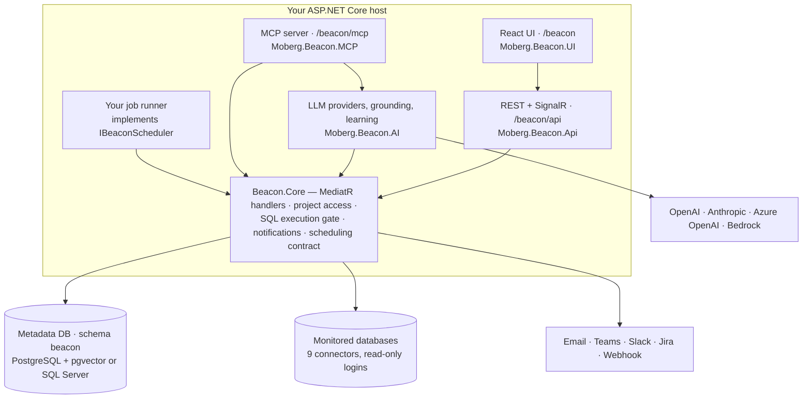

<div align="center">


# Beacon

**Watch your databases. Let AI in — safely.**

Scheduled SQL checks, alerts and data movement for .NET —
with a governed MCP server that gives AI assistants project-scoped, read-only, masked and audited access to your data.

[](https://moberghr.github.io/beacon)
[](https://www.nuget.org/packages/Moberg.Beacon.Core)
[](https://dotnet.microsoft.com/)
[](https://moberghr.github.io/beacon/features/mcp-server/)
[](LICENSING.md)

[Documentation](https://moberghr.github.io/beacon) ·
[Integrate](https://moberghr.github.io/beacon/integrate/) ·
[Quick start](https://moberghr.github.io/beacon/getting-started/quick-start/) ·
[Security model](https://moberghr.github.io/beacon/features/security-model/) ·
[MCP server](https://moberghr.github.io/beacon/features/mcp-server/)

<br/>


<sub>Sample data from Beacon's mock mode (<code>npm run dev:mock</code>).</sub>

</div>

---

## What Beacon is

Beacon is an operations layer between your databases, your team and your AI assistants. Point it at PostgreSQL, SQL Server, MySQL, Azure Synapse, Snowflake, BigQuery, Databricks, CloudWatch or a REST API, and it:

- **Watches** — runs multi-step SQL checks on a cron schedule, across engines, joined in memory.
- **Alerts** — sends results to Email, Microsoft Teams, Slack, Jira or a webhook; opens tasks and resolves them when the check comes back clean; flags statistical anomalies.
- **Serves AI** — exposes a Model Context Protocol server, so Claude, Cursor, VS Code or any MCP client can explore and query your data through one governed path.
- **Moves data** — when you turn it on: audited Insert, Upsert and Truncate-Load jobs into a data source an Admin marked as a write target.

It runs as a self-hosted reference app, or embeds into **your** ASP.NET Core application through the `Moberg.Beacon.*` NuGet packages — under your sign-in, your job runner and your deployment.

## Governed by default

Every SQL statement Beacon runs — from an MCP tool, a scheduled check, a preview or an AI feature — goes through **one execution gate**:

```
 question or SQL
       │
       ▼
 caller ───────────── API key, Entra caller or session · Execute scope · acting as its owner
       │
 project access ───── one evaluator · restricted projects answer 404 · data sources follow their projects
       │
 grounding ────────── M-Schema with join paths, glossary and verified examples — schema, not rows
       │
 SQL gate ─────────── deployment locks · length · characters · guardrail · dialect AST validator
       │              · cross-database rule · host policy · row cap written into the SQL
       ▼
 execution ────────── READ ONLY transaction on PostgreSQL and MySQL · statement timeout · read-only login
       │
 masking ──────────── PII masked fail-closed · database errors redacted
       │
 audit ───────────── every MCP call, refusals included · security events 7101–7123
```

| | |
|---|---|
| **Projects are the boundary** | New projects start restricted; outsiders get a 404. API keys name their projects. Scheduled work runs as its owner and is re-checked before every run. |
| **Duties, not just roles** | Approver, Auditor, SecurityAdmin, UserAdmin, DataSourceAdmin and MigrationOperator split the Admin role — none grants project data. |
| **Four-eyes approvals** | Turn them on and query changes, migration jobs, Custom SQL rules and new notification destinations go live only after a second person approves exactly what they saw. |
| **Deployment locks** | Read-only and PII detection are pinned on in configuration, binding even Admins. Row data to the LLM and content retention can be pinned off. |
| **Secrets** | AES-256-GCM connection strings, SHA-256-hashed API keys shown once, Data Protection keys encrypted at rest outside Development, server-side sessions with a 12-hour absolute lifetime. |
| **Honest per engine** | Database-level read-only on PostgreSQL and MySQL; on other engines the gate plus a read-only login — and a badge says so. |

Read the full [security model](https://moberghr.github.io/beacon/features/security-model/).

## Integrate it — or let Claude do it

The integration guide is written for people and for coding agents, and published as one Markdown file:

```text
Integrate Beacon into this ASP.NET Core app.
Read https://moberghr.github.io/beacon/llms-integrate.txt first and follow its checklist step by step.
Ask me before every decision the guide marks as one.
```

The core of an embedded host:

```csharp
builder.Services.AddBeaconServices(builder.Configuration, options =>
    {
        options.AddBeaconScheduler<BeaconScheduler>();   // your job runner (Warp, Hangfire, …)
        options.Authorization.Enabled = true;
        options.Authentication.EnableLoginForm = true;
        options.EnableUserManagement();
    })
    .AddPostgreSqlConnector()                           // engines you monitor
    .UsePostgreSql();                                   // Beacon's own data (ends the chain)

builder.Services.AddBeaconCookieAuthentication("/beacon");
builder.Services.AddBeaconApiAuthorization();
builder.Services.AddBeaconApiServices();
builder.Services.AddBeaconAI(builder.Configuration);
builder.Services.AddBeaconMcp();

var app = builder.Build();
Beacon.Core.ServiceConfiguration.UseBeacon(app.Services, createSchema: true);   // migrate Beacon's schema
// … the documented middleware order …
app.MapBeaconApi();        // /beacon/api
app.MapBeaconMcp();        // /beacon/mcp
app.MapMcpDiscovery();     // /.well-known/…
app.MapBeaconUi();         // /beacon
```

The full, annotated `Program.cs`, the middleware order and every option: **[Integrate Beacon →](https://moberghr.github.io/beacon/integrate/)**

## Run it locally

You need the .NET 10 SDK, Node.js 22 with npm 11 (to build the UI) and Docker.

```bash
git clone https://github.com/moberghr/beacon && cd beacon

# PostgreSQL with pgvector for Beacon's own data
docker run -d --name beacon-pg -e POSTGRES_PASSWORD=beacon -e POSTGRES_DB=beacon \
  -p 5432:5432 pgvector/pgvector:pg17

# Secrets (never committed)
dotnet user-secrets --project src/Beacon.SampleProject set "ConnectionStrings:BeaconContext" \
  "Host=localhost;Port=5432;Database=beacon;Username=postgres;Password=beacon"
dotnet user-secrets --project src/Beacon.SampleProject set "Beacon:EncryptionKey" "$(openssl rand -base64 32)"

# Beacon's schema (the sample host migrates only its job tables)
dotnet tool install --global dotnet-ef
dotnet ef database update --project src/Beacon.Core.PostgreSql \
  --startup-project src/Beacon.SampleProject --context PostgreSqlBeaconContext

# The host …
dotnet run --project src/Beacon.SampleProject --launch-profile https
# … and, in a second terminal, the UI dev server
npm ci --prefix src/Beacon.UI/web && npm run dev --prefix src/Beacon.UI/web
```

Open **http://localhost:5173/beacon/setup**. Beacon asks for a setup token — printed once to the host's console — and you create the first administrator. No credentials are hard-coded.

No backend at hand? `npm run dev:mock --prefix src/Beacon.UI/web` runs the whole UI against in-browser mock data at http://localhost:5173/beacon/.

📚 [Step-by-step quick start →](https://moberghr.github.io/beacon/getting-started/quick-start/)

## See it

<table>
  <tr>
    <td width="50%">
      
      <p align="center"><b>Control Tower</b> — live health of every scheduled check.</p>
    </td>
    <td width="50%">
      
      <p align="center"><b>Query editor</b> — Monaco SQL, live database explorer, multi-step chaining.</p>
    </td>
  </tr>
  <tr>
    <td width="50%">
      
      <p align="center"><b>MCP playground</b> — try the tools before you connect a client.</p>
    </td>
    <td width="50%">
      
      <p align="center"><b>Learning loop</b> — mined patterns are promoted only when replayed tests prove them.</p>
    </td>
  </tr>
  <tr>
    <td width="50%">
      
      <p align="center"><b>Approvals</b> — a second person reviews exactly what changes.</p>
    </td>
    <td width="50%">
      
      <p align="center"><b>Projects</b> — the access boundary, restricted by default.</p>
    </td>
  </tr>
</table>

## The MCP server

Streamable HTTP at `/beacon/mcp`. Authenticate with `Authorization: Bearer sk-sem_…` (an API key with the Execute scope, limited to its projects) or an Entra access token mapped to an MCP caller.

| Tool | What it does |
|---|---|
| `get_context` | Project overview — data sources, schemas, tables, documentation status; or an AGENTS.md-style brief |
| `search` | Keyword and semantic search over schemas, documentation and imported docs |
| `get_documentation` | Documentation at project, data-source or table level |
| `get_query_context` | The grounding `ask` uses — M-Schema with join paths, glossary, verified examples — so an agent can write its own SQL |
| `dry_run` | Validate SQL through every gate without running it |
| `query` | Run read-only SQL against one data source |
| `ask` | A question in plain language → routing → grounded SQL → gated execution |
| `feedback` | Rate an answer; a `correct` verdict waits for an Admin before it becomes a verified example |

Plus **saved-query tools** (`q_<name>`, published approved queries) and **host endpoint tools** (`api_<name>`, your own HTTP endpoints). Connect Claude Code in one line:

```bash
claude mcp add --transport http beacon https://beacon.example.com/beacon/mcp \
  --header "Authorization: Bearer $BEACON_MCP_API_KEY"
```

📚 [MCP server →](https://moberghr.github.io/beacon/features/mcp-server/) · [Connect AI clients →](https://moberghr.github.io/beacon/integrate/mcp/)

## Architecture



All project references point to `Beacon.Core`. One MediatR handler backs each REST endpoint, and CI checks that every handler is reachable over HTTP.

| Project | Role |
|---|---|
| `Beacon.Core` | Domain, handlers, project access, SQL gate, notifications, EF model |
| `Beacon.Core.PostgreSql` / `Beacon.Core.SqlServer` | Metadata database providers and their migrations |
| `Beacon.Api` | REST endpoints, SignalR hub, authentication, sessions, antiforgery |
| `Beacon.UI` | React app (`web/`) shipped as a Razor Class Library, served at `/beacon` |
| `Beacon.AI` | LLM providers, request queue, documentation, grounding, embeddings, AI actors |
| `Beacon.MCP` | MCP server, tools, filters, discovery documents, host endpoint tools |
| `Beacon.Connector.*` | PostgreSQL, SQL Server, MySQL, Synapse, Snowflake, BigQuery, Databricks, CloudWatch, REST API |
| `Beacon.SampleProject` | The reference host (never shipped): Warp jobs, OIDC, OpenTelemetry |
| `Beacon.Tests` | NUnit 4, Moq, FluentAssertions; EF translation tests and SQL goldens |

**Stack** — .NET 10 · C# 14 · ASP.NET Core · EF Core 10 (dual provider) · Dapper · MediatR · ModelContextProtocol · React 18 · Vite · TypeScript · Tailwind CSS · Vitest · about 7,000 backend test cases.

## Requirements

- .NET 10 SDK; Node.js 22 and npm 11 only to build the UI from source
- Beacon's metadata database: **PostgreSQL** with the `pgvector` extension available, or **SQL Server**
- `Beacon:EncryptionKey` — base64 of at least 32 random bytes, from a secret store
- A job runner for scheduled work (the sample uses [Moberg Warp](https://moberghr.github.io/warp/), which needs PostgreSQL)
- Optional: an LLM provider for AI features; an SMTP service for email; a local ONNX embedding model for semantic retrieval

## Docs for AI agents

| File | Content |
|---|---|
| [`llms.txt`](https://moberghr.github.io/beacon/llms.txt) | Index of every page |
| [`llms-integrate.txt`](https://moberghr.github.io/beacon/llms-integrate.txt) | The integration guide in one file |
| [`llms-full.txt`](https://moberghr.github.io/beacon/llms-full.txt) | The whole documentation |

Every page is also served as Markdown — append `.md` to its URL.

## Contributing and support

- [Issues](https://github.com/moberghr/beacon/issues) · [Discussions](https://github.com/moberghr/beacon/discussions)
- Contributions require the [CLA](CLA.md). Schema changes need a new migration for **both** providers ([MIGRATIONS.md](MIGRATIONS.md)).

## License

Dual-licensed: the [GNU AGPL v3.0](LICENSE), or a commercial licence without copyleft obligations. Moberg partners use Beacon under a [licence exception](LICENSE-EXCEPTION-PARTNERS.md). See [LICENSING.md](LICENSING.md).

---

<div align="center">
<sub>A <b>Moberg</b> product · <i>Serious engineering, infinite possibilities.</i></sub>
<br/>
<sub>© 2026 Moberg d.o.o. · <a href="https://moberghr.github.io/beacon">Documentation</a> · <a href="LICENSING.md">Licensing</a></sub>
</div>
