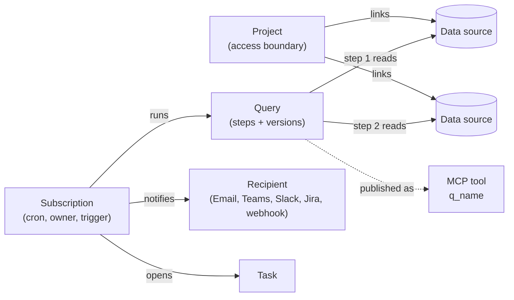

This page explains the objects Beacon works with and how they relate. Each section is short and links to the page with the details.

## How the objects relate

A query is reachable only through a project that links every data source it reads. A subscription runs one query on a schedule and delivers the rows to its recipients.

## Data source

A connection to a system Beacon reads: a database (PostgreSQL, SQL Server, MySQL, Azure Synapse, Snowflake), BigQuery, Databricks, AWS CloudWatch or a REST API described by OpenAPI. Each kind is served by a connector package.

- The connection string is encrypted at rest with `Beacon:EncryptionKey`. It is never shown again after you save it.
- Give every data source a **read-only database login**. Beacon also runs SQL read-only itself, and on PostgreSQL and MySQL inside a read-only transaction, but the login is the defence that holds on every engine.
- Beacon loads **metadata** (schemas, tables, columns, relationships) to power the query editor, the MCP catalog and SQL grounding.
- A new data source is usable only by Admins until it is linked into a project.

See [Data sources](/features/data-sources/).

## Project

The access boundary. A project links data sources and has members.

- **Members** hold a project role: Viewer, Editor or ProjectAdmin.
- **Restricted** projects are visible only to their members and Admins. Everyone else gets `404`. New projects are restricted and their creator becomes ProjectAdmin.
- **Open** projects are visible to every user with a Beacon role, at the level of that role.
- Queries, subscriptions, notifications, tasks and MCP calls are all filtered by the projects the caller can read.

See [Authorization](/security/authorization/) and [Security model](/security/).

## Query

Saved SQL, made of one or more **steps**. Each step runs on one data source.

- A later step reads an earlier step's rows as `@result1`, `@result2`, and so on. Beacon loads intermediate results into an in-memory SQLite database and runs the next step there, so a query can join data from different engines.
- `{name}` placeholders become **parameters**. Values are bound as database parameters, never pasted into the SQL.
- Changes are kept as **versions** you can compare and restore.
- A query can be **published as an MCP tool** (`q_<name>`) by a SecurityAdmin.

See [Queries](/features/queries/).

## Subscription

A query on a schedule.

- **Schedule**: a standard 5-field cron expression, for example `0 9 * * *` for 09:00 every day.
- **Owner**: the user the scheduled run acts as. Before every run Beacon re-checks that the owner may still run the query; a refused run is recorded as skipped, never run as the system.
- **Trigger**: when a run notifies: every execution, when the row count changes, or when it increases. A run that returns no rows never notifies.
- **Results**: max rows in the message, an optional CSV or XLSX attachment, an optional copy of the query text, and stored result rows.
- **Tasks**: optionally open a task while the query keeps returning rows.
- **Anomaly detection**: optionally notify only when the row count is unusual compared with earlier runs.
- **SLA**: an optional number of hours, shown on the subscription and its tasks.

Subscriptions cannot be edited after creation, except recipients, SLA and owner. See [Subscriptions](/features/subscriptions/) and [Anomaly detection](/features/anomaly-detection/).

## Recipient and notification

A **recipient** is a destination: Email, Microsoft Teams, Slack, Jira or a generic webhook. A **notification** is one delivery of one run's results, kept in the notification history with its status.

- Only an Admin or a SecurityAdmin creates or changes recipients.
- A **destination policy** decides where Beacon may deliver: HTTPS only, vendor hosts for Slack, Teams and Jira, public hosts for webhooks, and optional allow-lists and disabled channels set by the host (`Beacon:Notifications`).
- Email needs an email adapter registered by the host. The sample host's adapter sends through SMTP (`Beacon:Smtp:*`).
- Rows that reach recipients are PII-masked under the strictest settings of the projects involved.

See [Notifications](/features/notifications/).

## Task

A work item that opens when a subscription with task creation on returns rows, updates while later runs keep returning rows, and resolves itself when a run returns none. People assign, prioritise, snooze and comment on it.

See [Tasks](/features/tasks/).

## Data contract

A set of data-quality rules on one table (freshness, row count, uniqueness, nulls and more), evaluated on a cron schedule into a weighted score, with an alert when the score falls below a threshold. Contracts run on PostgreSQL, SQL Server and MySQL data sources. Only an Admin creates contracts that contain Custom SQL rules.

See [Data quality](/features/data-quality/).

## Approvals

An opt-in four-eyes workflow. When the host enables it, a change to a query's executable content, a migration job, a Custom SQL rule or a recipient's destination takes effect only after a second person with the Approver permission approves exactly the reviewed content. It is off by default.

See [Approvals](/security/approvals/).

## The SQL execution gate

Every statement Beacon runs on a data source passes one gate first, whoever asked for it: a subscription, a preview, a data contract or an MCP tool. The gate refuses anything but a single read-only statement, refuses names from other databases and SQL that switches context or runs dynamic SQL, and writes a row cap into the SQL. For subscriptions and previews, a result larger than `Beacon:Query:MaxExecutionRows` fails the run rather than being cut. Data migration, the only write path, is separate and off by default.

See [Security model](/security/) and [Queries](/features/queries/).

## MCP server and tools

`/beacon/mcp` serves AI clients over Streamable HTTP. Callers authenticate with an API key (`Authorization: Bearer sk-sem_…`) with the Execute scope, or with an Entra token mapped to a caller.

- **Eight built-in tools**: `get_context`, `search`, `get_documentation`, `get_query_context`, `dry_run`, `query`, `ask` and `feedback`.
- **Saved-query tools**: a published query appears as `q_<name>` and runs only its approved version.
- **Host endpoint tools**: a host can expose its own HTTP endpoints as `api_<name>` tools.

The caller's projects are resolved on every call, and every call is written to the audit log. See [MCP server](/mcp/server/), [Saved query tools](/mcp/saved-query-tools/) and [Host endpoint tools](/mcp/host-endpoint-tools/).

## Grounding and knowledge base

What Beacon gives an LLM to write SQL with: schema metadata, verified relationships, a business glossary, human-verified golden examples, learned patterns from usage, and project documentation. Curating it (verifying relationships, reviewing learned patterns, editing documentation) needs the Curate action in the project: ProjectAdmin members and Admins.

See [Knowledge base & grounding](/mcp/knowledge-base/).

## Roles, project roles and functional permissions

Three separate ideas:

| Concept | Values | Decides |
|---|---|---|
| Global role | Admin, Editor, Viewer | The highest level a user can have in any project. Admin has everything. |
| Project role | Viewer, Editor, ProjectAdmin | What a member may do in one project: read and run (Viewer), also write and query (Editor), also manage members and curate (ProjectAdmin). |
| Functional permission | Approver, Auditor, SecurityAdmin, UserAdmin, DataSourceAdmin, MigrationOperator | One administrative duty split out of the Admin role. Grants no project data by itself. |

API keys act as their owner, capped by their scope (Read or Execute), and never hold a functional permission. See [Authorization](/security/authorization/), [User management](/security/user-management/) and [API keys](/security/api-keys/).

## Deployment locks

Some settings are fixed by the host's configuration and cannot be changed from the UI or API, not even by an Admin. Examples: `Beacon:Mcp:ForceReadOnly` and `Beacon:Mcp:ForcePiiDetection` (both on by default), `Beacon:Mcp:ForbidRowDataToLlm`, and `Beacon:Migrations:Enabled` (off by default). Only a configuration change lifts a lock.

See [Configuration](/getting-started/configuration/) and [Admin settings](/security/admin-settings/).

## Audit

- **MCP audit log**: one row per MCP tool call, including refusals and errors, with every statement the call ran on a data source. Readable by Auditors and Admins.
- **Setting history**: every admin setting, MCP setting and migration-write-target change, with old value, new value and who changed it.
- **Security audit trail**: one append-only, signed event per security-relevant action (sign-ins, users and roles, API keys, project access, data sources, delivery, settings, approvals, ownership, curation, data quality, migrations and reads of audit data), by id only. Auditors read and verify it on the **Security Audit** page.
- **Security log events**: structured log events (event ids 7101 to 7123) for membership changes, refused access, sign-in events and more. They go to the host's log pipeline.

See [Security audit trail](/security/audit-trail/) and [MCP observability & audit](/mcp/observability-and-audit/).
