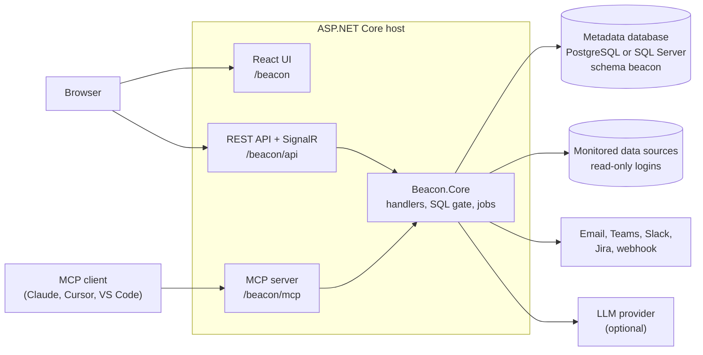

Beacon watches your databases and tells people when something is wrong. You write SQL against the databases you care about, schedule it, and Beacon delivers the rows to email, Microsoft Teams, Slack, Jira or a webhook. The same governed access to your data is offered to AI assistants through a built-in [MCP](https://modelcontextprotocol.io) server.

Beacon is a set of .NET 10 libraries with a React UI. You either run the sample host from the repository, or embed the NuGet packages in your own ASP.NET Core application.

## What it does

| Capability | What you get |
|---|---|
| Database monitoring | Queries with one or more steps across nine connectors: PostgreSQL, SQL Server, MySQL, Azure Synapse, Snowflake, BigQuery, Databricks, AWS CloudWatch and REST APIs (OpenAPI). |
| Alerting | Cron-scheduled subscriptions, notification triggers, tasks that stay open while a problem lasts, anomaly detection, data contracts, and a Control Tower view of their health. |
| Data movement | Data migration jobs that copy data into a database an Admin marked as a write target. Off unless the deployment turns it on. |
| Governed MCP server | `/beacon/mcp` for Claude, Cursor, VS Code and other MCP clients: eight built-in tools, saved queries published as tools, and optionally your own HTTP endpoints. SQL runs read-only, every call is scoped to the caller's projects and audited. |

## Who it is for

- **Data and platform teams** who want SQL-based alerts on production data without writing a service for each one.
- **Teams in regulated environments** who need read-only execution, project-level access control, four-eyes approvals and an audit trail.
- **.NET teams** who want to give AI assistants access to their data through one governed endpoint instead of database credentials.

## Two ways to run Beacon

| Path | Use it when | Start here |
|---|---|---|
| Run the sample host | You want to evaluate Beacon, or contribute to it. Clone the repository and run `Beacon.SampleProject`. | [Quick start](/getting-started/quick-start/) |
| Embed the packages | You run Beacon for real. Add the `Moberg.Beacon.*` packages to your own ASP.NET Core application, with your sign-in, job runner and deployment. | [Integrate Beacon](/integrate/) |

The sample host is a reference composition, not a product. Production deployments embed Beacon in their own host.

## How the pieces fit

- The UI, REST API and MCP server all live under `/beacon`. The site root `/` belongs to the host.
- Beacon keeps its own data (data sources, queries, users, audit) in the `beacon` schema of a PostgreSQL or SQL Server database.
- Connection strings to monitored databases are encrypted at rest with `Beacon:EncryptionKey`.
- Background work (scheduled subscriptions, re-indexing) runs on a job runner the host provides. The sample host uses [Moberg Warp](https://moberghr.github.io/warp/).

## Requirements

| You need | Notes |
|---|---|
| .NET 10 SDK | Every Beacon project targets `net10.0`. |
| A database for Beacon's own data | PostgreSQL with the [pgvector](https://github.com/pgvector/pgvector) extension available on the server, or SQL Server. |
| PostgreSQL for the sample's job runner | The sample host runs Warp, which needs PostgreSQL even when Beacon's own data is on SQL Server. |
| Node.js 22 and npm 11 | Only to build or run the React UI from source. Package consumers get the built UI inside `Moberg.Beacon.UI`. |
| An encryption key | Base64 of at least 32 random bytes, for example from `openssl rand -base64 32`. Beacon does not start without one. |

## Where next

- [Core concepts](/getting-started/concepts/): data sources, projects, queries, subscriptions and the rest of the model.
- [Quick start](/getting-started/quick-start/): run the sample host and send your first alert.
- [Run the sample host](/getting-started/installation/): what the sample includes and how to configure it.
- [Integrate Beacon](/integrate/): embed the packages in your own application.
- [Configuration](/getting-started/configuration/): every configuration key.
- [Routes & endpoints](/reference/routes/): every URL Beacon serves.
