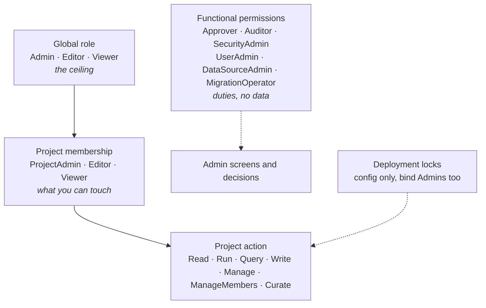

Beacon's access model has four layers. Set each one deliberately before people start using it.



## 1. Global roles

Every user has at most one global role, which caps everything else:

| Role | Can |
|---|---|
| **Viewer** | Read, and run existing checks, in projects they can reach. |
| **Editor** | Also create and change queries, subscriptions and other project content. |
| **Admin** | Everything, in every project, plus every functional permission. |

The first super admin is created at [first-run setup](/integrate/authentication/#beacons-user-store-and-first-run-setup). Give `Admin` to as few people as possible. The functional permissions below exist so that most administrative duties do not need it.

## 2. Projects are the access boundary

A **project** groups data sources and the queries, subscriptions, contracts and grounding built on them. Access is decided per project by one component, `IProjectAccessEvaluator`:

- **Restricted** projects are visible only to their **members** and to Admins. Everyone else gets **404**, so the existence of the project is not disclosed.
- **Open** projects are visible to everyone with a global role, at that role.
- **New projects start restricted**, with their creator as **ProjectAdmin**.
- A **data source follows the projects that link it**. Something that reads several data sources is reachable only through one project that links all of them. Data sources created after project access was introduced are Admin-only until linked to a project.

| Project role | Actions |
|---|---|
| Viewer | Read, Run |
| Editor | + Query (ad-hoc SQL, MCP queries), Write; + Manage in open projects |
| ProjectAdmin | + Manage, ManageMembers, Curate (review learned patterns, documentation and relationships) |

A global **Viewer** is a Viewer in every project, whatever their membership; Editors and Admins act with their membership role (and in an open project, with the higher of that and their global role). `ManageMembers` and `Curate` come only from a ProjectAdmin membership and are never granted to API keys, MCP callers or scheduled work.

**Make every project restricted** with `Beacon:Authorization:RequireProjectMembership: true`. Startup then requires a membership source (Beacon's user store, or your `IProjectMembershipSource`).

Plan the first projects before inviting users:

1. Create one project per team or data domain.
2. Link each data source to the projects that should see it.
3. Add members with the lowest role that works.

## 3. Functional permissions

Administrative duties are split out of the Admin role. Each is held through a **functional role** of the same name (a system role with no data access), assigned by an Admin, or mapped from an identity-provider app role at SSO sign-in.

| Permission | Grants |
|---|---|
| **Approver** | Approve or reject query changes and change requests (migration jobs, Custom SQL rules, recipient destinations). |
| **Auditor** | Read the MCP audit log, MCP settings, admin settings and every API key. |
| **SecurityAdmin** | Change MCP and admin settings (not the LLM connection or base URL, which are Admin only), manage notification recipients, publish saved queries as MCP tools, set repository tokens. |
| **UserAdmin** | Manage users and their non-privileged roles, end sessions, revoke API keys, change owners of scheduled work, manage project members, restrict projects. |
| **DataSourceAdmin** | Create, test and delete data sources; link them to projects they can read. |
| **MigrationOperator** | Create and run data-migration jobs (only when migrations are enabled). |

A functional permission grants **no project data**. A UserAdmin can never grant Admin or a functional role, nor touch Admins or other privileged users. API keys never hold a functional permission.

```json
{
  "Beacon": {
    "Authorization": {
      "RequireProjectMembership": true,
      "Roles": { "Approver": "Beacon Approver" },
      "IdpRoles": {
        "Enabled": true,
        "Map": {
          "Beacon.Auditor": "Auditor",
          "Beacon.SecurityAdmin": "SecurityAdmin"
        },
        "ClaimLifetimeMinutes": 60
      },
      "SeparationOfDuties": { "Enabled": true }
    }
  }
}
```

| Key | Default | What it does |
|---|---|---|
| `Roles:{Permission}` | the permission's name | Rename the functional role that grants a permission (not Admin/Editor/Viewer; unique). |
| `Roles:HonourHostRoleClaims` | `false` | Without Beacon's user store: let a role claim named like a functional role grant the permission. |
| `IdpRoles:Enabled` / `Map` | off | Map identity-provider app roles to permissions at SSO sign-in. Mapped permissions live in the session only and are not stored. |
| `IdpRoles:ClaimLifetimeMinutes` | `60` | How long a mapped permission counts after sign-in. |
| `SeparationOfDuties:Enabled` | `false` | Refuse giving one person both halves of a conflicting pair: Approver + SecurityAdmin, Auditor + SecurityAdmin, Auditor + UserAdmin, UserAdmin + Approver, UserAdmin + MigrationOperator. |

## 4. Change approvals (four-eyes)

Opt in with `options.EnableApprovalWorkflow(...)`. Then a change to a query's executable content goes live only after a **second person** with the Approver permission approves exactly the content they reviewed, and scheduled runs execute only reviewed SQL. By default it also covers migration jobs, Custom SQL rules and new or changed notification destinations.

```csharp
options.EnableApprovalWorkflow(x =>
{
    x.RequireApprovedVersionToRun = true;   // strict: run only versions with an approval for their exact content
    // x.AllowSelfApproval = true;          // only for a deployment with a single possible approver
    // x.CoversMigrationJobs = false;       // per-kind switches, all true by default
});
```

Make sure at least two people hold Approver (Admins count). Full rules: [Approvals](/features/approvals/).

## 5. Deployment locks

Some guarantees should not depend on an individual Admin's actions. These keys can only be changed in host configuration. The UI shows the setting disabled, and the API answers 409:

| Key | Default | Pins |
|---|---|---|
| `Beacon:Mcp:ForceReadOnly` | `true` | Read-only SQL everywhere the gate runs. |
| `Beacon:Mcp:ForcePiiDetection` | `true` | PII detection and masking on. |
| `Beacon:Mcp:ForceNoContentRetention` | `false` | No question, SQL or error text stored with MCP audit rows. |
| `Beacon:Mcp:ForbidRowDataToLlm` | `false` | No row values (samples, value grounding, eval judging) sent to the LLM provider. |
| `Beacon:Mcp:Ceilings:MaxRowLimit` | none | Upper bound for every project's MCP row limit. |
| `Beacon:Migrations:Enabled` | `false` | The only write path. Off: no migration endpoints, no jobs, for anyone. |

See [Security model](/features/security-model/) for how these fit together, and [Authorization](/features/authorization/) for the full reference.

## A starting configuration

For a typical company deployment:

- `RequireProjectMembership: true`
- SSO with `AllowedTenants`, `RequiredGroups`, `RequireMfa`; local login off with one break-glass account
- Two or more Approvers, one Auditor, one SecurityAdmin; `SeparationOfDuties` on
- Approval workflow on, with `RequireApprovedVersionToRun`
- Locks left at their defaults; `ForbidRowDataToLlm` on if row values must never reach your LLM provider
- Migrations off unless you need them
