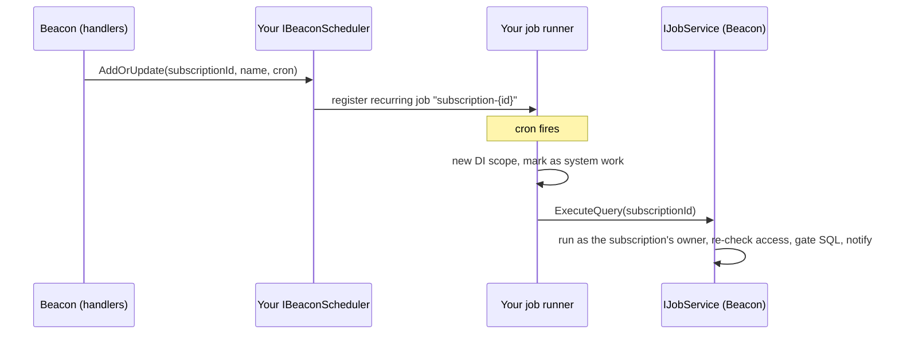

Scheduled checks, data-quality evaluations, documentation generation, AI actor cycles and maintenance all run as background jobs. Beacon defines **what** must run; your host decides **how**, through one interface: `IBeaconScheduler`.



## The contract

```csharp
namespace Beacon.Core.Worker;

public interface IBeaconScheduler
{
    Task AddOrUpdate(int subscriptionId, string subscriptionName, string cron);
    Task Remove(int subscriptionId, string subscriptionName);

    // The members below have default bodies that throw NotImplementedException.
    // Implement them to enable the feature that calls them.
    // EnqueueMetadataRefresh and EnqueueBackgroundTask are the exceptions: their defaults return null instead of throwing.
    Task AddOrUpdateDataQualityJob(int contractId, string contractName, string cron);   // data contracts
    Task RemoveDataQualityJob(int contractId, string contractName);
    Task<string> EnqueueProjectDocumentation(int projectId, int userId, string? notifyUserId); // AI documentation
    Task<string> EnqueueAiActorThinkCycle(int actorId, int subscriptionId);              // AI actors
    Task<string> EnqueueMcpEval(int runId);                                              // MCP evaluation runs
    Task<string?> EnqueueMetadataRefresh(int dataSourceId);                              // metadata re-scan after a connection target change
    Task<string?> EnqueueBackgroundTask(int taskId, string? notifyUserId);               // a task a user started and follows (metadata refresh, migration run, repository scan)
}
```

`EnqueueBackgroundTask` is optional too. Beacon records long work a user starts from the UI (a forced metadata
refresh, an AI actor's think-now, a manual migration run, a scan of a project's repositories, a project's documentation generation) as a background task and hands its id to this method; your job calls `IBackgroundTaskService.ExecuteAsync(taskId, ct)`
in a scope marked as system work; Beacon then runs it as the stored user who started it (by `Users.Id`) and re-checks
their access first (a task they may no longer run is recorded as skipped, and the job succeeds). It runs with the
user's own access, not the credential's: a start made with an API key is not capped by the key's scope or projects in
the job, and revoking or narrowing the key after the start does not stop it (disabling the user, or removing its
access, does). Return the job id (the UI follows
`JobStatusChanged` for it, sent to `notifyUserId`: the id the SignalR hub addresses the caller by, a signed-in
session's external id, or `null` for an API key or an MCP caller), or `null` (the default): Beacon then runs the task in
the request that started it, as before.

`EnqueueMetadataRefresh` is optional. Beacon calls it after a data source's connection is pointed at another target, to re-scan its metadata in the background. Return the job id, or `null` (the default) when your host runs no such job; Beacon then logs that the old schema stays until a manual refresh.

Register it with `options.AddBeaconScheduler<YourScheduler>()`. Without one, `AddBeaconServices` throws `Implementation of IBeaconScheduler is required.`

- `cron` is a standard **5-field** expression (validated by Beacon before it reaches you).
- Key recurring jobs by the **entity id** (`subscription-{id}`, `dq-{id}`), never by the name. Names change, ids do not.
- The `Enqueue…` methods return your runner's job id as a string. The UI correlates live `JobStatusChanged` events by that id; `notifyUserId` is the user who should receive them.

## What each job calls

Each job opens a **new DI scope**, marks it as system work, and calls one Beacon method:

| Job | Calls | Scheduled by |
|---|---|---|
| Subscription run | `IJobService.ExecuteQuery(subscriptionId, ct)` | `AddOrUpdate` / `Remove` |
| Data contract evaluation | `IJobService.EvaluateDataContract(contractId, ct)` | `AddOrUpdateDataQualityJob` / `RemoveDataQualityJob` |
| Project documentation (5.0 route and job) | `IProjectDocumentationService.GenerateDocumentationAsync(projectId, userId, ct)` (Beacon.AI) | `EnqueueProjectDocumentation` |
| AI actor think cycle | `IAiActorServiceExtended.ExecuteThinkCycleBackgroundAsync(actorId, subscriptionId)` (Beacon.AI) | `EnqueueAiActorThinkCycle` |
| MCP evaluation run | `IJobService.RunMcpEval(runId, ct)` | `EnqueueMcpEval` |
| Background task (metadata refresh, AI actor think-now, migration run, repository scan, documentation generation) | `IBackgroundTaskService.ExecuteAsync(taskId, ct)` | `EnqueueBackgroundTask` |

### Recurring maintenance jobs

Register these yourself at startup (the reference host's schedule):

| Id | Cron | Calls | Purpose |
|---|---|---|---|
| `mcp-learning-aggregate` | `0 */6 * * *` | `IJobService.AggregateLearnedPatterns` | Mine MCP usage signals into learned patterns. |
| `mcp-learning-cleanup` | `0 3 * * *` | `IJobService.CleanupOldSignals` | Delete signals past their retention. |
| `mcp-audit-retention` | `30 3 * * *` | `IMcpAuditRetentionService.PurgeExpiredAsync` | Purge MCP audit rows older than `Beacon:Mcp:Audit:RetentionDays` (no-op when unset or `0`). |
| `data-retention` | `50 3 * * *` | `IDataRetentionService.RunAsync` | Delete run history and logs older than `Beacon:Retention:Days` (no-op while it and every target are `0`, the default) and clear content older than `Beacon:Retention:ContentDays` (content first). A run works at most 50 minutes, each step within its share, and the next run continues what it left. `[Timeout]` one hour, `[Mutex]` one run at a time. See [Data retention](/getting-started/configuration/#data-retention-beaconretention). |
| `security-audit-retention` | `45 3 * * *` | `ISecurityAuditRetentionService.PurgeExpiredAsync` | Purge security audit events older than `Beacon:Audit:RetentionDays` (no-op when unset: events are kept forever). |
| `security-audit-verify` | `15 * * * *` | `ISecurityAuditVerificationService.VerifyNewEventsAsync` | Check events written since the last run against their integrity hashes; failures are logged at Error. |
| `mcp-embedding-reindex` | `0 */12 * * *` | `IJobService.ReindexEmbeddings` | Re-embed metadata and examples for semantic retrieval. Content that did not change since the last run (same text, model and version) is skipped, so a run costs what changed. |
| `mcp-docchunk-reindex` | `0 */12 * * *` | `IJobService.ReindexDocChunks` | Re-chunk and re-embed project documentation. |

One-off operator jobs:

- While `Beacon:PreviousEncryptionKeys` lists a key, run `IStoredValueReEncryptionService.ReEncryptAsync` once per start (the reference host checks `Beacon.Core.ServiceConfiguration.HasPreviousEncryptionKeys(configuration)`). Remove the old key when it reports nothing left.
- `IRecipientSecretEncryptionService.EncryptStoredSecretsAsync` encrypts recipient secrets stored before encryption existed. Run it once, by hand, after **every** instance runs the new version.

## The system-work rule

Beacon decides project access from the caller. A background job has no HTTP request, so it must say that it is Beacon's own work:

```csharp
scope.ServiceProvider.GetRequiredService<ISystemWorkScope>().MarkAsSystemWork();   // Beacon.Core.Authorization
```

Do this in the job's scope **before** Beacon code runs. An unmarked scope without a request gets **no project access** and logs a warning, and the job does nothing useful. Work done for a user (a subscription's scheduled run) is still executed **as that user**: Beacon sets the run-as owner itself and re-checks their access to the exact data sources right before any SQL or LLM call. A run the owner may no longer do is recorded as skipped and never run as the system. Do not resolve the current user in your job wrapper before Beacon's method runs.

## Reference implementation: Moberg Warp

[Moberg Warp](https://moberghr.github.io/warp/) is a PostgreSQL-backed job runner with recurring jobs and a dashboard. The reference host (`src/Beacon.SampleProject`) uses Warp 3.11; the code below matches it. Check the Warp docs if you use a newer major version.

```bash
dotnet add package Moberg.Warp.Core --version 3.11.0
dotnet add package Moberg.Warp.Worker --version 3.11.0
dotnet add package Moberg.Warp.Provider.PostgreSql --version 3.11.0
dotnet add package Moberg.Warp.UI --version 3.11.0          # optional dashboard
dotnet add package EFCore.NamingConventions                 # UseSnakeCaseNamingConvention
dotnet add package Microsoft.EntityFrameworkCore.Design     # for dotnet ef (same EF Core 10 version)
dotnet tool install --global dotnet-ef
```

**1. A dedicated context for Warp's tables** (the `warp` schema), kept apart from Beacon's:

```csharp
using Microsoft.EntityFrameworkCore;

public sealed class WarpDbContext(DbContextOptions<WarpDbContext> options) : DbContext(options);
```

Create its initial migration once in your project: `dotnet ef migrations add WarpInitial --context WarpDbContext`. Warp supplies the model.

**2. Registration and startup:**

```csharp
using Microsoft.EntityFrameworkCore;
using Warp.Core;
using Warp.Provider.PostgreSql;
using Warp.Worker;

public static class BeaconWarpSetup
{
    public static IServiceCollection AddBeaconWarp(this IServiceCollection services, IConfiguration configuration)
    {
        // Warp supports PostgreSQL; with Beacon on SQL Server, point WarpContext at a PostgreSQL database.
        services.AddDbContext<WarpDbContext>(x => x
            .UseNpgsql(configuration.GetConnectionString("WarpContext") ?? configuration.GetConnectionString("BeaconContext"))
            .UseSnakeCaseNamingConvention());

        services.AddWarpServer<WarpDbContext>(x =>
        {
            x.UsePostgreSql();
            x.PollingInterval = TimeSpan.FromSeconds(1);
            x.WorkerCount = Math.Min(Environment.ProcessorCount * 2, 20);   // protects the connection pool
            // No x.AddRetry(): failed Beacon jobs are investigated, not retried blindly.
        });

        return services;
    }

    public static async Task StartBeaconWarpAsync(this WebApplication app)
    {
        using var scope = app.Services.CreateScope();
        scope.ServiceProvider.GetRequiredService<WarpDbContext>().Database.Migrate();

        var recurring = scope.ServiceProvider.GetRequiredService<IRecurringJobPublisher>();
        await recurring.AddOrUpdateRecurringJob(new AggregateLearnedPatternsJob(), "mcp-learning-aggregate", "0 */6 * * *");
        await recurring.AddOrUpdateRecurringJob(new CleanupOldSignalsJob(), "mcp-learning-cleanup", "0 3 * * *");
        await recurring.AddOrUpdateRecurringJob(new PurgeExpiredMcpAuditLogsJob(), "mcp-audit-retention", "30 3 * * *");
        await recurring.AddOrUpdateRecurringJob(new PurgeExpiredSecurityAuditEventsJob(), "security-audit-retention", "45 3 * * *");
        await recurring.AddOrUpdateRecurringJob(new DataRetentionJob(), "data-retention", "50 3 * * *");
        await recurring.AddOrUpdateRecurringJob(new VerifySecurityAuditEventsJob(), "security-audit-verify", "15 * * * *");
        await recurring.AddOrUpdateRecurringJob(new ReindexEmbeddingsJob(), "mcp-embedding-reindex", "0 */12 * * *");
        await recurring.AddOrUpdateRecurringJob(new ReindexDocChunksJob(), "mcp-docchunk-reindex", "0 */12 * * *");
    }
}
```

**3. Mark every job as system work** with a pipeline behaviour (Warp's source generator registers it):

```csharp
using Beacon.Core.Authorization;
using Warp.Core.Handlers;

public sealed class SystemWorkBehavior<TRequest, TResponse>(ISystemWorkScope systemWork)
    : IPipelineBehavior<TRequest, TResponse>
    where TRequest : IRequest<TResponse>
{
    public Task<TResponse> HandleAsync(TRequest request, RequestHandlerDelegate<TRequest, TResponse> next, CancellationToken cancellationToken)
    {
        systemWork.MarkAsSystemWork();
        return next(request, cancellationToken);
    }
}
```

**4. One job + handler per Beacon entry point:**

```csharp
using Beacon.Core.SecurityAudit;
using Beacon.Core.Services.Retention;
using Beacon.Core.Worker;
using Warp.Core.Handlers;

public sealed class ExecuteSubscriptionQueryJob : IJob { public int SubscriptionId { get; init; } }
public sealed class ExecuteSubscriptionQueryJobHandler(IJobService jobs) : IJobHandler<ExecuteSubscriptionQueryJob>
{
    public Task HandleAsync(ExecuteSubscriptionQueryJob message, CancellationToken cancellationToken)
        => jobs.ExecuteQuery(message.SubscriptionId, cancellationToken);
}

public sealed class EvaluateDataContractJob : IJob { public int ContractId { get; init; } }
public sealed class EvaluateDataContractJobHandler(IJobService jobs) : IJobHandler<EvaluateDataContractJob>
{
    public Task HandleAsync(EvaluateDataContractJob message, CancellationToken cancellationToken)
        => jobs.EvaluateDataContract(message.ContractId, cancellationToken);
}

public sealed class RunMcpEvalJob : IJob { public int RunId { get; init; } }
public sealed class RunMcpEvalJobHandler(IJobService jobs) : IJobHandler<RunMcpEvalJob>
{
    public Task HandleAsync(RunMcpEvalJob message, CancellationToken cancellationToken)
        => jobs.RunMcpEval(message.RunId, cancellationToken);
}

public sealed class AggregateLearnedPatternsJob : IJob;
public sealed class AggregateLearnedPatternsJobHandler(IJobService jobs) : IJobHandler<AggregateLearnedPatternsJob>
{
    public Task HandleAsync(AggregateLearnedPatternsJob message, CancellationToken cancellationToken)
        => jobs.AggregateLearnedPatterns(cancellationToken);
}

public sealed class CleanupOldSignalsJob : IJob;
public sealed class CleanupOldSignalsJobHandler(IJobService jobs) : IJobHandler<CleanupOldSignalsJob>
{
    public Task HandleAsync(CleanupOldSignalsJob message, CancellationToken cancellationToken)
        => jobs.CleanupOldSignals(cancellationToken);
}

public sealed class ReindexEmbeddingsJob : IJob;
public sealed class ReindexEmbeddingsJobHandler(IJobService jobs) : IJobHandler<ReindexEmbeddingsJob>
{
    public Task HandleAsync(ReindexEmbeddingsJob message, CancellationToken cancellationToken)
        => jobs.ReindexEmbeddings(cancellationToken);
}

public sealed class ReindexDocChunksJob : IJob;
public sealed class ReindexDocChunksJobHandler(IJobService jobs) : IJobHandler<ReindexDocChunksJob>
{
    public Task HandleAsync(ReindexDocChunksJob message, CancellationToken cancellationToken)
        => jobs.ReindexDocChunks(cancellationToken);
}

public sealed class PurgeExpiredMcpAuditLogsJob : IJob;
public sealed class PurgeExpiredMcpAuditLogsJobHandler(IMcpAuditRetentionService retention) : IJobHandler<PurgeExpiredMcpAuditLogsJob>
{
    public Task HandleAsync(PurgeExpiredMcpAuditLogsJob message, CancellationToken cancellationToken)
        => retention.PurgeExpiredAsync(cancellationToken);
}

public sealed class PurgeExpiredSecurityAuditEventsJob : IJob;
public sealed class PurgeExpiredSecurityAuditEventsJobHandler(ISecurityAuditRetentionService retention) : IJobHandler<PurgeExpiredSecurityAuditEventsJob>
{
    public Task HandleAsync(PurgeExpiredSecurityAuditEventsJob message, CancellationToken cancellationToken)
        => retention.PurgeExpiredAsync(cancellationToken);
}

// [Timeout] and [Mutex] go on the job type (Warp.Core.Timeout, Warp.Core.Concurrency), never on the handler.
[Timeout(3600)]
[Mutex("data-retention")]
public sealed class DataRetentionJob : IJob;
public sealed class DataRetentionJobHandler(IDataRetentionService retention) : IJobHandler<DataRetentionJob>
{
    public Task HandleAsync(DataRetentionJob message, CancellationToken cancellationToken)
        => retention.RunAsync(cancellationToken);
}

public sealed class VerifySecurityAuditEventsJob : IJob;
public sealed class VerifySecurityAuditEventsJobHandler(ISecurityAuditVerificationService verification) : IJobHandler<VerifySecurityAuditEventsJob>
{
    public Task HandleAsync(VerifySecurityAuditEventsJob message, CancellationToken cancellationToken)
        => verification.VerifyNewEventsAsync(cancellationToken);
}
```

With AI enabled (`UseAI = true`), add the two AI jobs too:

```csharp
using Beacon.AI.Services.Ai.AiActor;          // IAiActorServiceExtended
using Beacon.AI.Services.Documentation;       // IProjectDocumentationService
using Warp.Core.Handlers;

public sealed class GenerateProjectDocumentationJob : IJob { public int ProjectId { get; init; } public int UserId { get; init; } }
public sealed class GenerateProjectDocumentationJobHandler(IProjectDocumentationService documentation) : IJobHandler<GenerateProjectDocumentationJob>
{
    public Task HandleAsync(GenerateProjectDocumentationJob message, CancellationToken cancellationToken)
        => documentation.GenerateDocumentationAsync(message.ProjectId, message.UserId, cancellationToken);
}

public sealed class AiActorThinkCycleJob : IJob { public int ActorId { get; init; } public int SubscriptionId { get; init; } }
public sealed class AiActorThinkCycleJobHandler(IAiActorServiceExtended actors) : IJobHandler<AiActorThinkCycleJob>
{
    public Task HandleAsync(AiActorThinkCycleJob message, CancellationToken cancellationToken)
        => actors.ExecuteThinkCycleBackgroundAsync(message.ActorId, message.SubscriptionId);
}
```

The reference host's versions are in `src/Beacon.SampleProject/Warp/Jobs/`.

**5. The scheduler:**

```csharp
using Beacon.Core.Worker;
using Microsoft.EntityFrameworkCore;
using Warp.Core;
using Warp.Core.Data.Entities;

public sealed class BeaconScheduler(
    IPublisher publisher,
    IRecurringJobPublisher recurring,
    WarpDbContext warp) : IBeaconScheduler
{
    public Task AddOrUpdate(int subscriptionId, string subscriptionName, string cron)
        => recurring.AddOrUpdateRecurringJob(new ExecuteSubscriptionQueryJob { SubscriptionId = subscriptionId }, $"subscription-{subscriptionId}", cron);

    public Task Remove(int subscriptionId, string subscriptionName)
        => RemoveRecurring($"subscription-{subscriptionId}");

    public Task AddOrUpdateDataQualityJob(int contractId, string contractName, string cron)
        => recurring.AddOrUpdateRecurringJob(new EvaluateDataContractJob { ContractId = contractId }, $"dq-{contractId}", cron);

    public Task RemoveDataQualityJob(int contractId, string contractName)
        => RemoveRecurring($"dq-{contractId}");

    public async Task<string> EnqueueMcpEval(int runId)
    {
        var id = await publisher.Enqueue(new RunMcpEvalJob { RunId = runId });
        await publisher.SaveChangesAsync();
        return id.ToString();
    }

    public async Task<string> EnqueueProjectDocumentation(int projectId, int userId, string? notifyUserId)
    {
        var id = await publisher.Enqueue(new GenerateProjectDocumentationJob { ProjectId = projectId, UserId = userId });
        await publisher.SaveChangesAsync();
        return id.ToString();
    }

    public async Task<string> EnqueueAiActorThinkCycle(int actorId, int subscriptionId)
    {
        var id = await publisher.Enqueue(new AiActorThinkCycleJob { ActorId = actorId, SubscriptionId = subscriptionId });
        await publisher.SaveChangesAsync();
        return id.ToString();
    }

    private async Task RemoveRecurring(string name)
    {
        var job = await warp.Set<RecurringJob>()
            .Where(x => x.Name == name)
            .FirstOrDefaultAsync();
        if (job == null)
        {
            return;
        }

        warp.Set<RecurringJob>().Remove(job);
        await warp.SaveChangesAsync();
    }
}
```

**6. The dashboard (optional).** Keep it Admin-only:

```csharp
var warpUi = new WarpUIOptions { RoutePrefix = "/warp" };
warpUi.Authorization = new AdminOnlyWarpFilter();   // IWarpAuthorizationFilter: authenticated + IsInRole("Admin")
WarpDashboardGuard.Require(warpUi.Authorization, warpUi.RoutePrefix);
app.UseWarpUI(warpUi);
```

Warp's default, with no filter, admits every request that reaches the route, and Beacon's login gate does not cover `/warp`. `WarpDashboardGuard.Require` (`Beacon.Api.Authentication`) throws when the filter it is given is null. Call it on the finished options' `Authorization` before mapping, as the sample's `UseGuardedWarpUI` does; a host that calls `UseWarpUI` directly is not checked.

The filter reads the Beacon session, which applies to `/beacon` and the prefixes in `Beacon:Authentication:AdditionalPaths` only: list `/warp` there (`"Beacon": { "Authentication": { "AdditionalPaths": [ "/warp" ] } }`), or the dashboard refuses every request.

### Live job status in the UI

The reference host also pushes `JobStatusChanged` (Processing / Succeeded / Failed) to the user who started a documentation job or a background task, through the SignalR hub. It tags the job with `BeaconUserId` metadata (the `notifyUserId` Beacon passes: the enqueuing user's hub user id, their `Users.ExternalId`) and a second pipeline behaviour sends the event to `Clients.User` with it; see `src/Beacon.SampleProject/Warp/JobStatusChangedBehavior.cs`. Without it everything works; the UI just does not show live progress for those jobs.

## Other job runners

Any runner works if it can (1) run a job in its own DI scope, (2) register, update and remove recurring jobs by name, and (3) enqueue a one-off job and return an id. A Hangfire sketch: wrap Beacon's calls in a class that marks system work first:

```csharp
using Beacon.Core.Authorization;
using Beacon.Core.Worker;
using Hangfire;

public sealed class BeaconHangfireJobs(ISystemWorkScope systemWork, IJobService jobs)
{
    public Task ExecuteSubscription(int subscriptionId)
    {
        systemWork.MarkAsSystemWork();
        return jobs.ExecuteQuery(subscriptionId, CancellationToken.None);
    }

    public Task EvaluateContract(int contractId)
    {
        systemWork.MarkAsSystemWork();
        return jobs.EvaluateDataContract(contractId, CancellationToken.None);
    }
}

public sealed class HangfireBeaconScheduler(IRecurringJobManager recurring) : IBeaconScheduler
{
    public Task AddOrUpdate(int subscriptionId, string subscriptionName, string cron)
    {
        recurring.AddOrUpdate<BeaconHangfireJobs>($"subscription-{subscriptionId}", x => x.ExecuteSubscription(subscriptionId), cron);
        return Task.CompletedTask;
    }

    public Task Remove(int subscriptionId, string subscriptionName)
    {
        recurring.RemoveIfExists($"subscription-{subscriptionId}");
        return Task.CompletedTask;
    }
}
```

Hangfire activates `BeaconHangfireJobs` in a scope per job when you use its ASP.NET Core integration. Turn its automatic retries off for these jobs (`[AutomaticRetry(Attempts = 0)]`), or a failed check reruns and notifies again.

## Operating notes

- **No automatic retries.** A failed run is recorded and visible in the UI; investigate it rather than retrying blindly. If one of your own jobs needs retries, configure them on that job only.
- **Worker count vs connection pool.** Each subscription run opens a Beacon context plus a connection to the monitored database. Cap workers so you do not exhaust the pool (the reference host uses `min(2 × CPU, 20)`).
- **Several instances.** Your runner must make sure a recurring job fires once across the cluster. Warp and Hangfire do this through their database.
- **A worker host without `Beacon.Api`.** A service that runs Beacon's jobs but serves no Beacon endpoints (a .NET Worker host referencing `Moberg.Beacon.Core` and a database provider only) keeps Core's request principal (`IBeaconRequestPrincipal`), which serves no request; every scope there runs off-request, so mark each job's scope as system work or set the owner it runs as. `Beacon.Api` registers `IBeaconUserContext`; such a host registers its own.
