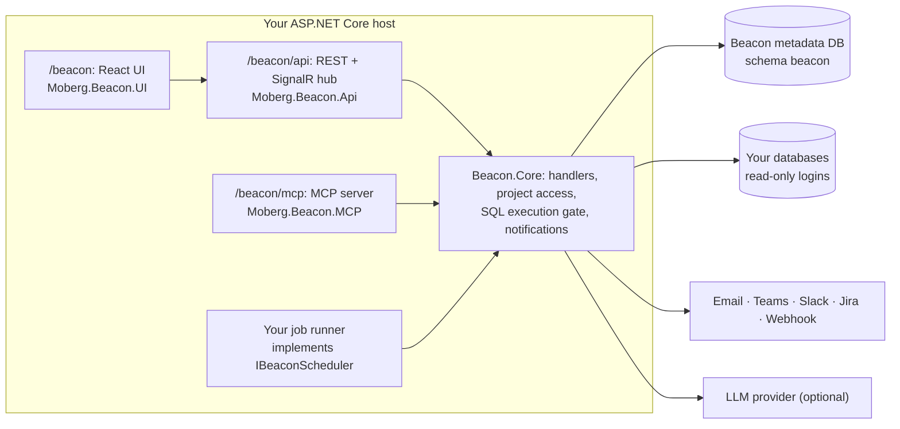

Beacon ships as a set of NuGet packages (`Moberg.Beacon.*`). You add them to an ASP.NET Core application, wire them in `Program.cs`, and your application serves Beacon's UI at `/beacon`, its REST API at `/beacon/api`, and its MCP server at `/beacon/mcp`, under your own sign-in, your own job runner and your own deployment.

This section is the complete integration guide. This page is the checklist; each step links to a page with every option for that step.

:::tip[Using Claude Code or another coding agent?]
Point it at the whole guide in one file (for an MCP gateway of your own application, use `llms-gateway.txt` instead):

```text
Integrate Beacon into this ASP.NET Core app.
Read https://moberghr.github.io/beacon/llms-integrate.txt first and follow its checklist step by step.
Ask me before every decision the guide marks as one.
```

Every page of these docs is also available as Markdown: add `.md` to the page URL, or use **Copy as Markdown** under the page title.
:::

## Which integration?

| You want | Follow |
|---|---|
| An MCP server for **your own application**: AI clients act as your signed-in users through your own endpoints and read your docs. No data sources, no SQL. | [MCP gateway for your application](/integrate/gateway/), one page, `llms-gateway.txt` |
| **Beacon's data product** in your application: monitored databases, queries, alerts, data movement, and an MCP server over them. | This checklist |

The two combine (a gateway host can add data sources later), but start with the one you need: the gateway path leaves out
most of this checklist (scheduler, connectors, login form, first-run setup) on purpose.

## Before you start

| You need | Notes |
|---|---|
| .NET 10 SDK | Every Beacon package targets `net10.0`. |
| An ASP.NET Core host | A minimal-API or MVC app. Beacon adds endpoints and middleware to it. |
| A database for Beacon's own data | PostgreSQL with the `pgvector` extension available, or SQL Server. Beacon keeps everything in the `beacon` schema. See [Metadata database](/integrate/database/). |
| A job runner | Beacon does not run background work itself. You implement `IBeaconScheduler` on your scheduler of choice; [Moberg Warp](https://moberghr.github.io/warp/) is the reference. See [Background jobs](/integrate/background-jobs/). |
| An encryption key | 32 random bytes, base64-encoded, from a secret store. Beacon refuses to start without one. |
| Node.js | Only if you build the UI package from source. Consumers of `Moberg.Beacon.UI` get the built SPA in the package. |

## Decisions to make first

These choices shape the wiring. An agent should ask, not guess.

| Decision | Options | Default if you have no preference |
|---|---|---|
| Metadata database | PostgreSQL (`Moberg.Beacon.Core.PostgreSql`) or SQL Server (`Moberg.Beacon.Core.SqlServer`) | PostgreSQL |
| Who signs users in | Beacon's own user store and login form, your OIDC provider (Entra ID or any OIDC), or your app's existing sign-in | Beacon user store + OIDC if you already have an identity provider |
| Job runner | Warp, Hangfire, Quartz.NET, or your own | Warp |
| Which engines Beacon monitors | Any of nine connectors | Only the engines you have |
| AI features | On (needs an LLM provider: OpenAI, Anthropic, Azure OpenAI or AWS Bedrock) or off | Off until you have a provider; MCP still needs the AI package |
| MCP server | Exposed to AI clients or not | Exposed, with API keys |
| Change approvals | Four-eyes review of query, migration, Custom SQL and recipient changes, off by default | On for regulated deployments |
| Data migration (the only write path) | Off (default) or on | Off |

## The checklist

1. **Add the packages.** At minimum `Moberg.Beacon.Core`, a metadata-database provider, `Moberg.Beacon.Api`, `Moberg.Beacon.UI`, and one connector per engine you monitor. Add `Moberg.Beacon.AI` + `Moberg.Beacon.MCP` for the MCP server. → [Packages](/integrate/packages/)

2. **Set the two required secrets.** `ConnectionStrings:BeaconContext` and `Beacon:EncryptionKey` (`openssl rand -base64 32`). Never commit either. → [Host wiring](/integrate/host-setup/#configuration)

3. **Implement `IBeaconScheduler`** on your job runner, and make sure every job marks its DI scope as system work. Without a scheduler `AddBeaconServices` throws at startup. → [Background jobs](/integrate/background-jobs/)

4. **Register services in `Program.cs`:** `AddBeaconServices(...)` with your options, connectors, then `UsePostgreSql()` / `UseSqlServer()` last in the chain; cookie authentication with base path `/beacon`; Data Protection; `AddBeaconApiAuthorization()`, `AddBeaconApiServices()`, antiforgery; `AddBeaconAI` and `AddBeaconMcp` if you use them. → [Host wiring](/integrate/host-setup/)

5. **Build the middleware pipeline in the documented order.** The order is load-bearing: MCP challenge → API keys → JWT bearer → authentication → Beacon cookie → authorization → login form → first-run setup → antiforgery. → [Host wiring](/integrate/host-setup/#the-middleware-pipeline)

6. **Map the endpoints:** `MapBeaconApi()`, `MapLoginEndpoints("/beacon", …)`, `MapSetupEndpoints("/beacon")`, `MapBeaconMcp()`, `MapMcpDiscovery()`, `MapBeaconUi()`. → [Host wiring](/integrate/host-setup/#endpoints)

7. **Migrate Beacon's schema at startup** with `Beacon.Core.ServiceConfiguration.UseBeacon(app.Services, createSchema: true)`. Beacon does not migrate itself. → [Metadata database](/integrate/database/)

8. **Choose how people sign in:** Beacon's login form, OIDC/SSO (tenant allow-list, guest blocking, MFA), bearer JWTs, API keys. Plan the first-run admin and a break-glass account. → [Sign-in & identity](/integrate/authentication/)

9. **Decide who sees what:** projects are the access boundary; functional permissions split the Admin role; optional four-eyes approvals. → [Access control](/integrate/access-control/)

10. **Configure connectors** for the engines you monitor, each with a read-only database login. → [Data-source connectors](/integrate/connectors/)

11. **Optional, AI (required for MCP):** set `UseAI = true`, call `AddBeaconAI`, configure the LLM provider and, optionally, local embeddings. → [AI providers](/integrate/ai/)

12. **Optional, MCP (needs step 11):** expose `/beacon/mcp`, set `Beacon:PublicBaseUrl`, issue API keys or map Entra callers, connect Claude, Cursor or VS Code. → [MCP & AI clients](/integrate/mcp/)

13. **Optional, extend:** expose your own EF Core `DbContext`, your Markdown docs, or your own HTTP endpoints as MCP tools. → [Extending Beacon](/integrate/extending/)

14. **Harden for production:** Data Protection keys encrypted at rest, forwarded headers behind a proxy, deployment locks, audit retention, setup token, session affinity for MCP. → [Production checklist](/integrate/production/)

15. **Verify.** Start the app and check, in this order:
    - The console prints `Beacon first-run setup token (enter it on the setup page): …` (user management on, empty database).
    - `/beacon/setup` creates the first administrator, in the browser, or [headless](/integrate/authentication/#headless-first-run-scripts-and-ci).
    - `GET /beacon/api/health` answers `200` (until the first admin exists it redirects to `/beacon/setup`).
    - You can sign in and see **Home** at `/beacon/home`.
    - `GET /.well-known/mcp/server-card.json` lists the eight MCP tools (if you mapped MCP).
    - An API key with the Execute scope can list the MCP tools. See [Check it works](/integrate/mcp/#check-it-works).

    If something fails, see [Troubleshooting](/integrate/troubleshooting/).

## What you get



Beacon never takes over the root of your site: everything lives under `/beacon` and `/.well-known/…` (MCP discovery). Your own routes, auth schemes and pages keep working.

## The reference host

`src/Beacon.SampleProject/Program.cs` in the repository is a complete, running composition with every connector, Warp jobs, OIDC, bearer JWT for MCP, OpenTelemetry and forwarded headers. It is a sample, never shipped as a package. [Run it](/getting-started/quick-start/) to see a working Beacon before you embed one, and compare your `Program.cs` with it when something behaves differently.
