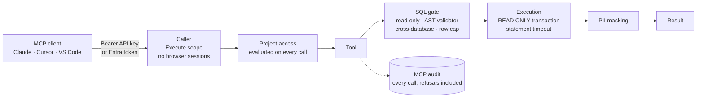

Beacon serves a **Model Context Protocol (MCP)** server at `/beacon/mcp`. Through it, AI assistants (Claude, Claude
Desktop, Claude Code, Cursor, VS Code and any other MCP client) work with your data and your application under the
same rules as people: they reach only the projects they are given, run read-only SQL only, see masked values only, and
every call they make is audited.

:::tip[Hand this section to your AI]
The whole MCP section is published as one file for agents. Paste this into Claude Code, Cursor or any coding agent:

```text wrap
Read https://moberghr.github.io/beacon/llms-mcp.txt. It is the documentation of Beacon's MCP server.
Then help me with: <what you want, e.g. "connect Claude Code to our Beacon at https://beacon.example.com">.
Ask me before every decision the docs mark as one, and never put an API key or secret in a committed file.
```
:::

## Two ways to use it

| | **Beacon's MCP server** over your databases | **MCP gateway** for your own application |
|---|---|---|
| Agents reach | Your data: the catalog, documentation, read-only SQL, approved saved queries, and optionally your endpoints | Your application: a set of its endpoints, run as the signed-in person, and its documents |
| Who connects | API keys with the Execute scope, limited to projects, or mapped Microsoft Entra callers | Your application's own users, signed in with Microsoft Entra (delegated tokens) |
| SQL | Yes, read-only, through the execution gate | None: no data sources, no SQL tools |
| Package | `Moberg.Beacon.MCP` on a full Beacon | `Moberg.Beacon.Gateway`, about thirty lines of `Program.cs` |
| Start with | [Connect a coding agent](/cookbooks/connect-coding-agent/) | [MCP gateway for your application](/mcp/gateway/) |

Both run the same server, filters and audit. They combine: a full Beacon can expose host endpoints as tools, and a
gateway host can add Beacon's data product later.

## The tools

Eight built-in tools, plus the ones you add. Every tool is published with a title and safety annotations, so clients can
show what a call does before it runs.

| Tool | What it does | Typical use |
|---|---|---|
| `get_context` | Project overview: data sources, schemas, tables, documentation status | First call of a session |
| `search` | Keyword search over tables, columns and documentation, fused with semantic matching when local embeddings are on | "Where do we keep refunds?" |
| `get_documentation` | Documentation at project, data-source or table level | Reading what a table means |
| `get_query_context` | The grounding `ask` uses: schema with join paths, glossary and verified examples | Before an agent writes its own SQL |
| `dry_run` | Validates SQL through every gate without running it | Checking SQL before `query` |
| `query` | Runs read-only SQL against one data source, row-capped and masked | Getting the numbers |
| `ask` | Answers a natural-language question: routing, grounded SQL generation, gated execution | One-shot business questions |
| `feedback` | Rates an answer; a `correct` verdict becomes a verified example only after an Admin reviews it | Teaching Beacon what good looks like |
| `q_<name>` | An approved [saved query](/mcp/saved-query-tools/) published as a tool, with typed parameters | Repeatable, reviewed reports |
| `api_<name>` | One of your own [HTTP endpoints](/mcp/host-endpoint-tools/), run as the caller through its own authorization | Actions and reads in your application |

The gateway serves your `api_<name>` tools plus `get_context`, `search` and `get_documentation` over your documents.
Every tool, argument and limit is described on [Server & tools](/mcp/server/).

## How a call is governed



- **Credentials, not sessions.** `/beacon/mcp` accepts an API key with the Execute scope or a mapped bearer token. A
  signed-in browser session gets `403`; people try the tools in the **MCP playground** inside Beacon instead.
- **Projects are the boundary.** The caller's projects are decided on every call, so a revoked membership takes effect
  on the next call. A call that names a project outside them is refused, and the refusal is audited.
- **Read-only, enforced twice.** Every statement passes the [SQL execution gate](/security/#6-the-sql-execution-gate),
  and PostgreSQL and MySQL also run it in a read-only transaction. Read-only enforcement and PII detection are
  deployment locks, on by default, that even an Admin cannot switch off at runtime.
- **Audited, including refusals.** Every tool call is recorded with its caller, timing and outcome. What is kept
  (questions, SQL, error text) is a per-project setting that the host can pin.

The full model is on [Security](/security/).

## Connect a client

With an API key (`sk-sem_…`, Execute scope, created under **API Keys** in Beacon):

```bash
claude mcp add --transport http beacon https://beacon.example.com/beacon/mcp \
  --header "Authorization: Bearer $BEACON_MCP_API_KEY"
```

| Client | How |
|---|---|
| Claude Code, Cursor, VS Code | An API key in a header: [Connect a coding agent](/cookbooks/connect-coding-agent/) |
| claude.ai, Claude Desktop, Cowork | A custom connector that signs in with Microsoft Entra: [Claude connector with Entra](/cookbooks/claude-connector-entra/) |
| Agent platforms and services | Entra tokens mapped to user or system callers: [Entra ID callers](/mcp/entra-callers/) |
| Anything else | Streamable HTTP and JSON-RPC by hand: [Connect AI clients](/mcp/connect/#check-it-works) |

Then ask it something. Example prompts for the first session are in the [prompt library](/cookbooks/prompts/#ask-your-data).

## Make it yours

| You want agents to | Use |
|---|---|
| Run a reviewed report with parameters, not free SQL | [Saved query tools](/mcp/saved-query-tools/) |
| Call your application's endpoints as the signed-in person | [Host endpoint tools](/mcp/host-endpoint-tools/), or the whole [gateway](/mcp/gateway/) |
| Understand your EF Core model | [Host DbContext](/mcp/host-dbcontext/) |
| Read your own Markdown documentation | [Host docs](/mcp/host-docs/) |
| Write better SQL from your glossary and verified examples | [Grounding & knowledge base](/mcp/knowledge-base/) |
| Use fewer built-in tools, or other server instructions | `AddBeaconMcp(x => …)`: see [Connect AI clients](/mcp/connect/#wiring) |

## Operate it

- **See what agents did:** the MCP audit, the `Beacon.Audit` log events, OpenTelemetry spans and metrics, and retention:
  [Observability & audit](/mcp/observability-and-audit/), or the recipe [Ship the MCP audit to your SIEM](/cookbooks/audit-to-siem/).
- **Pin what nobody may change:** read-only, PII detection, content retention, row data to the LLM and numeric ceilings
  under `Beacon:Mcp`: [Deployment locks and ceilings](/mcp/server/#deployment-locks-and-ceilings).
- **Check a deployment from outside:** `beacon-doctor mcp https://your-app/beacon/mcp` walks the sign-in path the way a
  client does: [Verify a deployment](/mcp/gateway/#8-verify-a-deployment).
- **Test your tools in CI:** `Moberg.Beacon.Testing` gives a real MCP client over your test server:
  [Expose an endpoint as a tool](/cookbooks/endpoint-as-tool/).

## Packages

| Package | For |
|---|---|
| `Moberg.Beacon.MCP` | The MCP server on a full Beacon (`AddBeaconMcp`, `MapBeaconMcp`, `MapMcpDiscovery`) |
| `Moberg.Beacon.Gateway` | The MCP gateway for your own application (`AddBeaconMcpGateway`, `UseBeaconMcpGateway`, `MapBeaconMcpGateway`) |
| `Moberg.Beacon.Testing` | Test tokens, test users and an MCP client for a gateway host's tests |
| `Moberg.Beacon.Doctor` | The `beacon-doctor` .NET tool that checks a deployed endpoint |

## In this section

- [Server & tools](/mcp/server/): every tool, argument, guardrail, limit and setting
- [Connect AI clients](/mcp/connect/): wiring, discovery documents, API keys or Entra, client set-up, checking by hand
- [Entra ID callers](/mcp/entra-callers/): user and system callers from Microsoft Entra, and Claude's custom connector
- [Observability & audit](/mcp/observability-and-audit/): audit rows, log events, spans, metrics, retention
- [MCP gateway for your app](/mcp/gateway/): the whole gateway recipe
- [Saved query tools](/mcp/saved-query-tools/), [Host endpoint tools](/mcp/host-endpoint-tools/),
  [Host DbContext](/mcp/host-dbcontext/), [Host docs](/mcp/host-docs/),
  [Grounding & knowledge base](/mcp/knowledge-base/)
