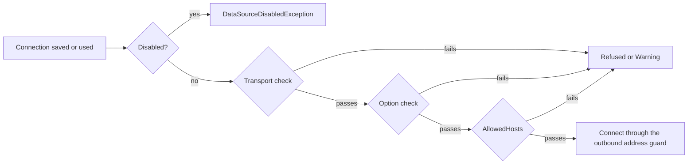

Beacon connects to your databases and APIs with credentials an administrator typed in. Those connections are a security boundary, so Beacon checks each one when it is saved and again when it is used. This page lists what is accepted, what is refused and which settings change the behaviour.

Three checks run on every connection:

1. **Transport.** The connection must authenticate the server over TLS.
2. **Driver options.** Options that read files on the Beacon host, load code, sign in as the Beacon host or leak values are refused.
3. **Hosts.** When `Beacon:DataSources:AllowedHosts` is set, every host the connection names must be on the list.



A refusal is a `DataSourceTransportException`. Its message names the option and says what to change. It never contains a value from the connection.

## Transport: TLS with server authentication

Each connector has a transport inspector that parses the connection with the driver's own builder.

| Engine | Required | Refused option named in the message |
|---|---|---|
| PostgreSQL | `SSL Mode=VerifyFull` | `SSL Mode` |
| MySQL | `SslMode=VerifyFull` | `SslMode` |
| SQL Server, Azure Synapse | `Encrypt=Mandatory` or `Strict` (or `Encrypt` left out), and no `TrustServerCertificate=true` | `Encrypt`, `TrustServerCertificate` |
| Snowflake | no `insecureMode=true`, `certRevocationCheckMode` left at `ENABLED`, `scheme` left at `https` | `insecureMode`, `certRevocationCheckMode`, `scheme` |
| API connector | `BaseUrl` and `OpenApiSpecUrl` are absolute `https://` URLs | `BaseUrl`, `OpenApiSpecUrl` |
| Databricks, BigQuery, CloudWatch | always pass (these clients use HTTPS only) | none |

A data source type with no registered inspector is never verified. It counts as unverified and follows the same new and stored rules below.

### Accepted and refused examples

```text
# PostgreSQL
Accepted: Host=db.example.com;Database=sales;Username=beacon_ro;Password=<secret>;SSL Mode=VerifyFull
Refused:  Host=db.example.com;Database=sales;Username=beacon_ro;Password=<secret>;SSL Mode=Require

# MySQL
Accepted: Server=db.example.com;Database=sales;User=beacon_ro;Password=<secret>;SslMode=VerifyFull
Refused:  Server=db.example.com;Database=sales;User=beacon_ro;Password=<secret>;SslMode=Required

# SQL Server and Synapse
Accepted: Server=db.example.com;Database=sales;User Id=beacon_ro;Password=<secret>;Encrypt=True;TrustServerCertificate=False
Refused:  Server=db.example.com;Database=sales;User Id=beacon_ro;Password=<secret>;Encrypt=True;TrustServerCertificate=True

# Snowflake
Accepted: account=example-org;user=beacon_ro;password=<secret>;db=SALES
Refused:  account=example-org;user=beacon_ro;password=<secret>;db=SALES;insecureMode=true
```

API connector connection data (JSON):

```json
{
  "BaseUrl": "https://api.example.com/v1",
  "OpenApiSpecUrl": "https://api.example.com/v1/openapi.json",
  "Auth": { "Type": "Bearer", "Token": "<token>" }
}
```

Changing `BaseUrl` to `http://api.example.com/v1` is refused with `Beacon requires a data-source connection that authenticates the server over TLS. Set BaseUrl to an absolute https:// URL.`

### Refusal message shapes

```text
Beacon requires a data-source connection that authenticates the server over TLS. {Remedy}.
Beacon does not accept the data-source connection option {Option}. {Remedy}.
Beacon:DataSources:AllowedHosts is set, and Beacon cannot tell which hosts this connection reaches. Name the server's host explicitly.
The connection reaches a host that Beacon:DataSources:AllowedHosts does not list. Connect to a listed host, or ask the operator to add it.
```

A connection string the driver cannot read is refused with the option name `connection string` and the remedy "Enter a connection string the engine's driver can read".

## Driver options

A second inspector, per engine, reads the options. Each refused option has one of two risks.

- **Unsafe** options are always refused. Only `Beacon:DataSources:Transport:AllowInsecure` lifts them.
- **Host credential** options make the connection sign in as the Beacon host or read the host's files. They are refused unless `Beacon:DataSources:AllowHostCredentials` is `true`.

### Refused options per engine

| Engine | Always refused | Refused unless `AllowHostCredentials` |
|---|---|---|
| PostgreSQL | `Options`, `Passfile`, `Include Error Detail`, `Log Parameters` | a Unix-socket `Host` (starts with `/` or `@`), `GSS Encryption Mode=Require`, a `Require Auth` that admits GSS or SSPI, `SSL Certificate`, `SSL Key`, `SSL Password`, an empty `Password` |
| MySQL | `AllowLoadLocalInfile`, `AllowLoadLocalInfileInPath`, `CommandInterceptors`, `ExceptionInterceptors` | `IntegratedSecurity`, `DefaultAuthenticationPlugin` set to a Kerberos, Windows or OCI plugin, `OciConfigFile`, `CertificateStoreLocation`, a `.pfx` `CertificateFile` (the same as `SslCa`), `CertificatePassword`, `SslCert`, `SslKey`, a `ConnectionProtocol` other than TCP, an empty `Password` |
| SQL Server, Synapse | `AttachDBFilename`, `User Instance`, interactive `Authentication` (`ActiveDirectoryInteractive`, device code) | `Integrated Security`, any `Authentication` other than `SqlPassword`, `ActiveDirectoryPassword` or `ActiveDirectoryServicePrincipal`, `Column Encryption Setting=Enabled`, a `Data Source` starting with `np:`, `lpc:` or `(localdb)` |
| Snowflake | `client_config_file`, `disable_saml_url_check=true`, authenticator `externalbrowser` or `oauth_authorization_code` | authenticator `workload_identity`, `private_key_file` |
| BigQuery | a credential that is not a service account key, or a key whose `token_uri`, `universe_domain` or other URLs are not Google's | no `ServiceAccountJson` at all (signs in with the host's application default credentials) |
| Databricks | a `Host` that is not a bare host name (no scheme, port, path, query or user part) | none |
| CloudWatch | a `Region` that is not an AWS region name | a `ProfileName`, or no `AccessKeyId` and `SecretAccessKey` (uses the host's profile or IAM role) |
| API connector | none | none |

### CA files are accepted

A CA file only verifies the server, so it needs no option. These are accepted without `AllowHostCredentials`: PostgreSQL `Root Certificate`, MySQL `SslCa` with a PEM file (not `.pfx`), and SQL Server `ServerCertificate`. A client certificate or key is different: it proves who the Beacon host is, so it is a host credential option.

The MySQL driver Beacon pins has no SSH tunnel options. Its builder refuses them, so a connection that sets them is unreadable and refused.

## AllowedHosts

`Beacon:DataSources:AllowedHosts` is a list. Empty means unrestricted, which is the default.

| Entry | Matches |
|---|---|
| `db.example.com` | exactly that host, ignoring case |
| `203.0.113.10` | that IP address, compared in canonical form |
| `*.example.com` | any host below `example.com`, not `example.com` itself |

Rules:

- Matching is by name. Beacon does not pin the resolved address.
- A host that is not a bare ASCII name or IP address matches nothing. Write internationalised names in their `xn--` form.
- `AllowInsecure` never lifts this list.
- While the list is set, a connection whose hosts Beacon cannot determine is refused. A MySQL `DnsSrv` lookup is one such case.
- Snowflake counts the account host (underscores become hyphens unless `allowunderscoresinhost`), the proxy host when `useproxy` is on, an Okta authenticator host and the OAuth token, authorization and redirect hosts. BigQuery counts the key's `token_uri` host. Databricks counts `Host`. SQL Server counts `Data Source` and `Failover Partner`.
- A host-managed source gets the host check only, never the option check.

Startup fails on a bad entry:

```text
Beacon:DataSources:AllowedHosts entries 1 are not host names: use a host name, an IP address or *.example.com, without a scheme, port or path.
```

## New and stored connections

| Case | What happens |
|---|---|
| New or changed connection (create, update, test-connection) | Refused with `DataSourceTransportException`. |
| Stored connection that fails a check | Keeps working. One Warning per data source per process. |
| Stored connection with `Beacon:DataSources:Transport:EnforceOnExisting` on | Refused when it becomes a live connection. One Warning per data source per process. |

The Warnings name the data source id and the option, never a value:

```text
Data source 7 connects without authenticating the server over TLS (SSL Mode). It keeps working until its connection is replaced; Beacon:DataSources:Transport:EnforceOnExisting refuses it
```

Stored connections are checked in `IDataSourceConnectionResolver` (`GetConnectionString`, `GetConnectionData`, and `GetWriteConnectionString` for the migration writer). Nothing else decrypts a stored connection to connect.

### Settings

| Key | Type | Default | Range | What it does |
|---|---|---|---|---|
| `Beacon:DataSources:Transport:EnforceOnExisting` | bool | `false` | true or false | Refuse stored connections that fail the transport or option check. |
| `Beacon:DataSources:Transport:AllowInsecure` | bool | `false` | true or false | Lift the transport check, the always-refused options and the loopback block. For development hosts only. Logs a startup Warning outside Development. |
| `Beacon:DataSources:AllowHostCredentials` | bool | `false` | true or false | Allow options that sign in as the Beacon host. |
| `Beacon:DataSources:AllowedHosts` | string list | empty | host, IP or `*.domain` | Hosts a connection may name. Empty means any. |
| `Beacon:DataSources:Outbound:AllowPrivateNetworks` | bool | `true` | true or false | Let the API connector and Databricks clients reach private addresses. |
| `Beacon:DataSources:Outbound:AllowLoopback` | bool | `false` | true or false | Let them reach loopback. `AllowInsecure` also lifts this. |
| `Beacon:Notifications:Nat64Prefixes` | string list | empty | IPv6 `/96` with no host bits set | Extra NAT64 prefixes. The address inside is judged as its IPv4 address. |

Environment variable form:

```bash
Beacon__DataSources__Transport__EnforceOnExisting=true
Beacon__DataSources__AllowedHosts__0=db.example.com
Beacon__DataSources__AllowedHosts__1=*.warehouse.example.com
```

JSON form:

```json
{
  "Beacon": {
    "DataSources": {
      "AllowHostCredentials": false,
      "AllowedHosts": [ "db.example.com", "*.warehouse.example.com" ],
      "Transport": { "EnforceOnExisting": true },
      "Outbound": { "AllowPrivateNetworks": true, "AllowLoopback": false }
    }
  }
}
```

### Recommended values

| Key | Development | Production | Regulated profile |
|---|---|---|---|
| `Transport:EnforceOnExisting` | `false` | `true` | must be `true` |
| `Transport:AllowInsecure` | `true` only on a laptop | `false` | must not be `true` |
| `AllowHostCredentials` | `false` | `false` | must not be `true` |
| `AllowedHosts` | empty | list every host | must be non-empty |

## Outbound address rules

The API connector and Databricks use named HTTP clients (`ApiConnectorHttpClient.Name` and `BeaconHttpClients.Databricks`). Their connect callback (`OutboundAddressGuard`) resolves the host, drops every address the rules refuse, and connects only to an address it checked. A DNS answer that changes between the check and the connect cannot redirect the call.

| Address class | Result |
|---|---|
| Link-local and cloud metadata, unspecified, multicast, reserved | Always refused, also in IPv6 forms (mapped, translated, compatible, NAT64, 6to4) |
| Loopback | Refused unless `Outbound:AllowLoopback` or `Transport:AllowInsecure` |
| Private networks (`10/8`, `172.16/12`, `192.168/16`, `100.64/10`, `fc00::/7`) | Allowed unless `Outbound:AllowPrivateNetworks` is `false` |
| NAT64 under `64:ff9b::/96` and your `Nat64Prefixes` | Judged by the IPv4 address inside |

HTTP/3 is off. Through a system proxy the destination is checked before sending. A refusal is a `DataSourceTransportException` that names the rule, never the address or URL.

### API connector request hardening

- No redirects, no cookies, no request logging.
- A query cannot set routing, method-override, framing or credential headers: `Host`, `Forwarded`, `Via`, `X-Real-IP`, `X-Client-IP`, `True-Client-IP`, `CF-Connecting-IP`, `X-Cluster-Client-IP`, `Fastly-Client-IP`, `X-Original-URL`, `X-Rewrite-URL`, `X-Original-Host`, `X-Host`, `X-HTTP-Method`, `X-HTTP-Method-Override`, `X-Method-Override`, `Content-Length`, `Transfer-Encoding`, `TE`, `Trailer`, `Connection`, `Keep-Alive`, `Upgrade`, `Expect`, `Authorization`, `Cookie`, and any `X-Forwarded-*` or `Proxy-*`.
- Header names must be HTTP tokens. Header values must not hold control characters.
- Paths must not hold `.` or `..` segments (also percent-encoded, or behind a `;` path parameter), control characters, `#` or `?`. The resolved URL must stay under the base URL's path.
- The data source's own credentials (a token, API key value or password of 8 or more characters, in plain, URL-encoded and JSON-escaped forms) are replaced with `***` in responses before tabularising.
- A new connection with `Auth.ApiKeyLocation` set to `Query` is refused: `Send the API key in a header (Auth.ApiKeyLocation Header): a key in the query string travels in every request URL, which servers and proxies log, and an API that echoes its URL returns it.` A stored one logs one Warning per source per process.

## Rotating credentials

`PUT /beacon/api/data-sources/{id}` replaces a connection in place. It needs the DataSourceAdmin permission (an Admin has it). The stored connection is never returned. A null or empty `connectionString` keeps the stored one.

```http
PUT /beacon/api/data-sources/7
Content-Type: application/json

{
  "name": "Sales (read-only)",
  "databaseEngineType": "PostgreSQL",
  "connectionString": "Host=db.example.com;Database=sales;Username=beacon_ro;Password=<new secret>;SSL Mode=VerifyFull",
  "confirmTargetChange": false
}
```

Same engine, host, port and database: the answer is `204 No Content`. The old driver pool is emptied.

If the new connection points at another engine, host, port or database, or Beacon cannot read the target, the answer is `409 Conflict` until the body sets `confirmTargetChange` to `true`:

```text
The new connection points at another server, port, database or engine. Confirm the target change to save it: the column values sampled from the old target are removed.
```

A confirmed change removes the sampled column values of the old target and enqueues a metadata re-scan. The old tables stay visible until it finishes. An engine change needs the connection entered again. Host-managed sources are refused.

## Disabling a source

```http
PUT /beacon/api/data-sources/7/enabled
Content-Type: application/json

{ "enabled": false }
```

The answer is `204 No Content`, at once, without a second approval. A disabled source makes no connection. Every resolver path refuses it first, before decrypting or checking transport, with `DataSourceDisabledException`:

```text
This data source is disabled: Beacon makes no connection with it until a DataSourceAdmin enables it again.
```

Queries, previews, subscription runs, data-quality checks, MCP tools, AI paths and metadata scans on it fail. A subscription run is recorded as failed with the comment `Failed: a data source this query reads is disabled.` The stored catalog is not served and cached metadata is evicted. Host-managed sources cannot be disabled.

## Approvals

When `ApprovalWorkflow.CoversDataSourceConnections` is on, a new data source is saved held, and a change to any non-secret setting waits for a second person. A change to the secrets alone is still an immediate rotation. See [Approvals](/security/approvals/) for the four-eyes rules and how a held source is released.

## Audit events

Every action is staged in the security audit trail with ids, counts, flags and codes only. See [Audit trail](/security/audit-trail/).

| Action | When |
|---|---|
| `data_sources.data_source_created` | A source is created. |
| `data_sources.data_source_updated` | A source is edited and the connection did not change. Names the changed fields and whether the target changed. |
| `data_sources.credentials_rotated` | The connection changed. |
| `data_sources.data_source_deleted` | A source is deleted. |
| `data_sources.data_source_disabled` | A source is disabled. |
| `data_sources.data_source_enabled` | A source is enabled again. |

## Troubleshooting

| Symptom | Cause and fix |
|---|---|
| `... authenticates the server over TLS. Set SSL Mode to VerifyFull` | Set the mode named in the message, and make sure the server certificate chains to a CA the Beacon host trusts. Add a CA file option if it does not. |
| `Beacon does not accept the data-source connection option X` | Remove the option, or for a host credential option ask the operator to set `AllowHostCredentials`. |
| The hosts cannot be told | Name the server host directly instead of a DNS SRV lookup. |
| Warning per stored source after upgrade | Replace the connection, or turn off `EnforceOnExisting` until you do. |
| 409 on update | The target changed. Send `confirmTargetChange: true` if that is intended. |
| API source refused for `ApiKeyLocation.Query` | Send the key in a header. |
| Outbound refusal naming a rule | The address is link-local, loopback or private. Change the host or the `Outbound` settings. |

## Related pages

- [Secrets and keys](/security/secrets-and-keys/)
- [SQL execution gate](/security/sql-execution-gate/)
- [Approvals](/security/approvals/)
- [Audit trail](/security/audit-trail/)
- [Regulated profile](/security/regulated-profile/)
- [Connectors and read-only logins](/integrate/connectors/#creating-read-only-logins)
- [Configuration](/getting-started/configuration/)
