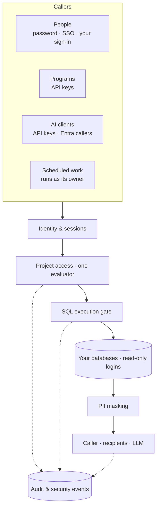

Beacon sits between people, AI assistants and production databases. Its security model assumes that any of them can make mistakes, and that an administrator's convenience should not quietly weaken a guarantee. This page is the map; each section links to the detail.

## 1. Identity

- **Sign-in paths:** Beacon's login form (PBKDF2-SHA256 passwords, 10 attempts per minute per IP, a 15-minute lockout after 5 wrong passwords), OIDC/SSO with tenant allow-list, guest blocking, required groups or app roles and optional MFA, bearer access tokens, API keys, or your own host's sign-in. → [Sign-in & identity](/integrate/authentication/)
- **First run** needs a setup token; until an administrator exists nobody else can be provisioned.
- **Break-glass:** with password sign-in off, at most three named accounts may still use a password; each use is logged as a warning (7119).
- **MFA** (`RequireMfa`) covers the interactive SSO sign-in. Bearer tokens, API keys, MCP callers and break-glass passwords are not MFA-protected. Protect them with short lifetimes, project lists and alerting.

## 2. Sessions

- The `Beacon.Auth` cookie is HttpOnly, SameSite=Lax and Secure on HTTPS; state-changing API calls need an antiforgery token.
- Sessions are **revalidated on the server** every few minutes (user enabled, not archived, unchanged security stamp; roles reloaded) and end **12 hours** after sign-in however often they are renewed.
- Changing a user's roles, password or status renews their security stamp and ends every session they have; realtime connections close with them.
- The cookie's key ring (ASP.NET Core Data Protection) must be encrypted at rest outside Development, or the host does not start.

## 3. Projects are the access boundary

One component, the project access evaluator, decides every access, for the UI, the API, MCP and scheduled work alike:

- **Restricted** projects are visible only to members and Admins; everyone else gets **404**. New projects start restricted.
- A **data source follows its projects**; anything that reads several data sources needs one project that links them all.
- **API keys** are confined to the projects they name and capped by the lower of their scope and their owner's role, and never the Admin bypass.
- **Scheduled work runs as its recorded owner**, re-checked right before every SQL statement or LLM call. If the owner may no longer do it, the run is recorded as skipped and is never run as the system.
- **Grounding is project-scoped:** glossary terms, verified examples, learned patterns and evaluation cases of one project never reach another project's prompts, even when the projects share a data source.

Every MediatR request declares how it is authorized, and tests fail when a new request does not. → [Authorization](/security/authorization/)

## 4. Separated duties

The Admin role's duties are split into six **functional permissions** (Approver, Auditor, SecurityAdmin, UserAdmin, DataSourceAdmin, MigrationOperator), each grantable without any project data. Optional separation of duties refuses risky combinations (for example Approver + SecurityAdmin). A UserAdmin can never grant Admin or a functional role. API keys never hold a functional permission. → [Access control](/integrate/access-control/#3-functional-permissions)

## 5. Four-eyes approvals

With the approval workflow on (opt-in), changes that decide what SQL runs or where data goes take effect only after a **second person** approves exactly what they reviewed: query changes, migration jobs, Custom SQL rules and notification destinations, and, when switched on, data-source connections and the LLM connection. Approvals are bound to a content hash, the requester cannot approve, and scheduled runs execute only reviewed SQL. → [Approvals](/security/approvals/)

## 6. The SQL execution gate

Every SQL statement Beacon runs (MCP tools, previews, scheduled checks, saved-query tools, data-quality rules, AI features, value probes, migration reads and the final query of a cross-source join) passes **one gate** before it reaches a database:

| # | Stage | What it does |
|---|---|---|
| 1 | Deployment lock | `Beacon:Mcp:ForceReadOnly` (default on) forces read-only whatever the caller asked. |
| 2 | Length | SQL longer than the ceiling (100,000 characters by default) is refused. |
| 3 | Characters | Control characters other than tab/LF/CR and Unicode non-characters are refused. |
| 4 | Guardrail | Write and DDL patterns are refused, judged after the dialect's own tokenizer strips comments. |
| 5 | AST validator | The SQL is parsed in the data source's dialect; anything but a read is refused. An unknown dialect is refused. |
| 6 | Cross-database rule | Names qualified with another database, catalog or project; remote servers, files and storage; `USE`, `SET ROLE`, `EXECUTE AS`; SQL built from strings or variables are all refused. Always on, even with read-only off. |
| 7 | System catalog rule | The engine's catalog, statistics and query-history relations (`pg_catalog` and `pg_…`, `information_schema`, `sys`, Snowflake `QUERY_HISTORY` and `RESULT_SCAN`, …) are refused; a source's tables and columns come from Beacon's metadata. Always on, even with read-only off. |
| 8 | Host policy | For a host-exposed DbContext: only allow-listed tables and columns. |
| 9 | Row cap | The cap is written into the SQL, overriding any bound the statement sets itself. Scheduled runs, previews and Beacon's own reads **fail** above the cap; MCP `query` and `ask` return the capped rows and say the result was truncated. Nothing is cut silently. |

Then the statement runs on the data source's provider:

| Engine | Database-level enforcement |
|---|---|
| PostgreSQL | `READ ONLY` transaction, exactly one statement per batch |
| MySQL | `START TRANSACTION READ ONLY`, statement batches off |
| SQL Server | A transaction that is always rolled back; a statement that ends it fails the run (7116) |
| Synapse, Snowflake | None beyond the gate |
| BigQuery | The connector's own parser check and a dry run whose statement type must be `SELECT` |
| Databricks | The connector's own parser check and configured catalog |

The gate is the primary control and database-level read-only is defence in depth, so **every data source needs a read-only login**, on every engine. Data sources whose engine cannot refuse writes carry a badge, and Beacon warns at startup. Every statement has a timeout: `Beacon:Query:StatementTimeoutSeconds` (120 s by default) for scheduled runs, previews and Beacon's own reads, and the project's MCP statement timeout (30 s by default) for MCP `query`, `ask` and the saved-query tools. Every statement also honours the caller's cancellation.

## 7. Masking and what leaves Beacon

- **PII masking** (on by default, pinned by `Beacon:Mcp:ForcePiiDetection`) masks columns detected as PII (and their aliases, renames and wildcard expansions) in results that reach MCP clients, recipients and attachments. When Beacon cannot prove where a PII column went, it masks every column (fail closed). Host DbContext sources mask by output position.
- **Database errors are redacted:** errors that can carry values (constraint violations, conversion failures) are reduced to their class; others keep their message with quoted values replaced.
- **LLM providers receive schema, not rows**, unless a project turns on sample-value collection, value grounding or the eval judge (all off by default; `Beacon:Mcp:ForbidRowDataToLlm` pins them off). Every request that carries row-derived data is logged as event 7123 with the categories sent, never the values.
- **Content retention:** a project (or the deployment, with `ForceNoContentRetention`) can keep MCP audit rows structural only (tool, tables, counts, timings, error class, keyed hashes), with no question, SQL or error text stored. A deployment that must keep that evidence pins retention on instead with `Beacon:Mcp:Audit:RequireContent`.

## 8. Secrets at rest

- Data-source connection strings, tokens and recipient secrets are encrypted with **AES-256-GCM** (per-value nonce) under `Beacon:EncryptionKey`. The key is checked at startup in every environment and rotated through `Beacon:PreviousEncryptionKeys` and a re-encryption job.
- API keys are stored as **SHA-256 hashes**; the raw key is shown once.
- A host-exposed DbContext stores only the **name** of its connection string, never the string.
- Secrets never reach logs; notification calls are excluded from HTTP tracing because their URLs can carry secrets.

## 9. Outbound notifications

Notification destinations must be HTTPS on the channel's vendor hosts (Slack, Teams, Jira) or on public hosts (webhooks), unless `Beacon:Notifications` allows more. Private, loopback, link-local and cloud-metadata addresses are unreachable unless explicitly listed, and every connection is vetted at connect time. Only a SecurityAdmin (or Admin) manages recipients; new or changed destinations can require approval. → [Notifications](/features/notifications/)

## 10. One write path, off by default

Beacon only writes to your data through **data migration**, which is off unless the host sets `Beacon:Migrations:Enabled`. Even then it writes only into a data source an Admin marked as a write target (PostgreSQL, MySQL or SQL Server; never a host-managed or read-only one), Beacon never reads from a write target, and with approvals on every job definition is reviewed by a second person. → [Data migration](/features/data-migration/)

## 11. Deployment locks

Some settings are pinned by host configuration and bind Admins too. The UI shows them disabled and the API answers 409:

| Key | Default |
|---|---|
| `Beacon:Mcp:ForceReadOnly` | `true` |
| `Beacon:Mcp:ForcePiiDetection` | `true` |
| `Beacon:Mcp:ForceNoContentRetention` | `false` |
| `Beacon:Mcp:ForbidRowDataToLlm` | `false` |
| `Beacon:Mcp:Audit:RequireContent` | `false` |
| `Beacon:Mcp:Ceilings:MaxRowLimit` | none (SQL length 100,000 and question length 4,000 always apply) |
| `Beacon:Migrations:Enabled` | `false` |
| `Beacon:UserManagement:LocalLogin:*` | password sign-in on |

Every MCP setting change is recorded in the settings history with who changed it.

`Beacon:Profile: Regulated` requires the regulated values of these locks and of the audit, retention, row-data, ceiling, rate-limit and sign-in settings: it fills the keys a host left unset and fails startup, listing each, on any key set weaker; it never overrides a host value. A startup report (event 9130) names every weaker setting, also without the profile. → [Regulated profile](/getting-started/configuration/#regulated-profile-beaconprofile)

## 12. Audit and security events

| Record | Where | Who reads it |
|---|---|---|
| **Security audit trail**: one append-only event per security-relevant action: sign-ins and sign-outs, users and roles, API keys, project access, data sources, delivery, settings, saved queries, approvals, ownership, alert tasks, curation, data contracts, migration jobs, and every read of audit data. Ids, codes and keyed digests only, no personal data or secrets | `SecurityAuditEvents` table; each event signed (HMAC-SHA256 under `Beacon:Audit:IntegrityKey`), verified on request, on the schedule the host sets (hourly in the sample host) and before a purge; kept forever unless `Beacon:Audit:RetentionDays` is set; copied to the `Beacon.Audit` log stream (9104) once committed | Auditors, on the **Security Audit** page or through `GET /beacon/api/security-audit` (each read itself recorded) |
| **MCP audit log**: one row per tool call, refusals and failures included: tool, caller, project, data source, rows, timing, trace id, MCP session id, a keyed hash of the parameters, and every statement the call ran on a data source (its SQL where the project retains content) | `McpAuditLog` and `McpAuditStatement` tables; optional fail-closed mode (`Beacon:Mcp:Audit:Required`); retention via `RetentionDays` | Auditors, through `GET /beacon/api/mcp/audit` (each read recorded in the security audit trail) |
| **Settings history**: admin settings, MCP settings, migration write-target changes, with old and new value (secrets as `***`) | `AppSettingHistory` table | Auditors and SecurityAdmins |
| **Security log events**: structured log events 7101 to 7123 with ids only, no personal data | Your log pipeline. The log events themselves are not stored; the actions most of them report are also recorded in the security audit trail. Refused and hidden reads (7108, 7109), skipped scheduled work (7111), read-only transaction ends (7116), key-ring and re-encryption notices (7121, 7122) and row data sent to the LLM (7123) are on the log only | Your SIEM |

Queries, subscriptions, recipients, data contracts and migration jobs also record who created them and who changed them last; an Auditor or a UserAdmin lists what a user owns, created or changed last. → [Security audit trail](/security/audit-trail/)

| Event | Id | Event | Id |
|---|---|---|---|
| MemberAdded | 7101 | UserRolesChanged | 7113 |
| MemberRoleChanged | 7102 | UserCreated | 7114 |
| MemberRemoved | 7103 | MigrationWritesChanged | 7115 |
| AccessModeChanged | 7104 | ReadOnlyTransactionEnded | 7116 |
| DataSourcesLinked | 7105 | UserSessionsRevoked | 7117 |
| RepositoryScanRequested | 7106 | SessionEnded | 7118 |
| RepositoryTokenChanged | 7107 | BreakGlassSignIn | 7119 |
| AccessRefused | 7108 | PasswordSignInRefused | 7120 |
| AccessHidden | 7109 | DataProtectionKeyRing | 7121 |
| DataSourceUnlinked | 7110 | StoredValuesReEncrypted | 7122 |
| ScheduledWorkSkipped | 7111 | RowDataSentToLlm | 7123 |
| ProjectCreatedOpen | 7112 | | |

Alert at least on 7119 (break-glass), 7113/7114 (role changes, new users), 7115 (write targets) and 7116 (a statement tried to end SQL Server's read-only transaction), and on any increment of the counters `beacon.security_audit.write_failures` (a security audit event was not stored) and `beacon.security_audit.verification_failures` (stored events failed verification). → [MCP observability & audit](/mcp/observability-and-audit/)

## Your part

Beacon's guarantees assume the host does its share:

- read-only logins on every data source;
- secrets in a secret store, Data Protection keys encrypted at rest;
- `UseForwardedHeaders` with known proxies, and `Beacon:PublicBaseUrl` set, behind a reverse proxy;
- HSTS and `AllowedHosts` set by the host, and Beacon's origin check switched to `Enforce` once its warnings are gone;
- the middleware order from [Host wiring](/integrate/host-setup/#the-middleware-pipeline);
- every job scope marked as system work;
- security log events and the `Beacon.Audit` category (including the security audit trail's copies and verification checkpoints, 9104 to 9114) shipped to a monitored log store;
- `Beacon:Audit:IntegrityKey` set from a secret store, and the security audit verification and retention jobs scheduled (the sample host schedules both).

The [production checklist](/integrate/production/) collects all of these.
