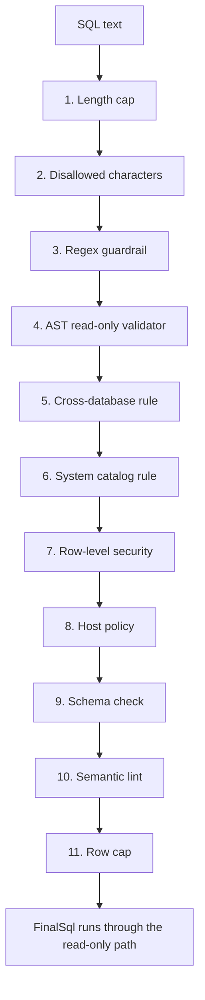

Beacon runs SQL on your data sources for several features: the MCP tools `query`, `ask` and `dry_run`, saved-query tools, query previews, subscriptions, AI actor checks, data contract rules, column value samples and migration reads. Every one of them sends its statement through one component, the **SQL execution gate** (`ISqlExecutionGate`), before anything connects to the data source.

The gate exists because a text-to-SQL system must never trust the text it is given. It protects against:

- writes and other side effects hidden in a `SELECT` (stacked statements, `SELECT ... INTO`, data-changing CTEs, locking hints)
- reads that leave the data source's boundary (another database, a linked server, a file, a URL, a model)
- reads of the engine's own catalog, statistics and query history, which can expose values and other people's queries
- result sets large enough to exhaust memory or a warehouse budget

Read this page when you need to know exactly what Beacon refuses and why, when you tune the limits, or when a user reports a refused query and you need to explain the message. The short overview is in [Security overview, section 6](/security/#6-the-sql-execution-gate). The gate is defence in depth: it is the main control, and a read-only database login (see [Database-level read-only](#database-level-read-only)) is the second.

## How the gate works

The gate is pure and synchronous. It does no I/O, so it can judge every candidate statement, including every repair attempt of the `ask` tool, for the cost of a parse. It returns a report with the verdict of each stage, the SQL to run (`FinalSql`) and, when it blocks, the reason. What runs on the data source is always the gate's own `FinalSql`, never SQL changed after the gate.

The stages run in this order. A failure in an early stage skips the later ones (their verdict is `not_evaluated`).



| # | Stage | Verdict code on failure | Blocks always? |
|---|-------|-------------------------|----------------|
| 1 | Length cap | `sql_too_long` | Yes |
| 2 | Disallowed characters | `disallowed_character` | Yes |
| 3 | Regex guardrail | `guardrail` (or `empty` for blank SQL) | Only while read-only enforcement is on, except blank SQL and a custom PII pattern that cannot be evaluated, which always fail |
| 4 | AST read-only validator | `ast` | Only while read-only enforcement is on |
| 5 | Cross-database rule | `cross_database` | Yes, also with read-only off |
| 6 | System catalog rule | `system_catalog` | Yes, also with read-only off |
| 7 | Row-level security | `no_entitlement`, `row_security_unrewritable` | Yes |
| 8 | Host policy | `host_policy` | Yes |
| 9 | Schema check | `schema` | Only where the caller asks it to block (the MCP `query` tool does) |
| 10 | Semantic lint | none (findings only) | No, advisory |
| 11 | Row cap | `uncappable_bound`, `invalid_row_cap`, `too_deep` | Yes |

Other codes are not failures: `not_requested` (the caller did not ask for the stage), `not_evaluated` (an earlier stage blocked), `disabled` (switched off by settings), `already_limited`, `own_bound_capped`, `not_applicable`, `textual_fallback`, `empty_catalog` and `parse_failed`.

Stages 5 to 8 are **authorization**, not advice: they block whatever the read-only and schema settings say. Only the statement that joins step results on Beacon's own in-memory SQLite database skips stages 5 and 6, because it reaches no other database.

### Two ways the gate is called

- **Features of Beacon itself** (previews, subscriptions, AI actor checks, data contract rules, samples, migration reads) go through `GatedSqlRunner`. It always runs the gate with read-only enforcement on, a mandatory row cap and a statement timeout, and refuses a statement that names a database other than the one the connection is configured for.
- **MCP tools** call the gate with the effective MCP settings of the project (the strictest of the projects that link the data source). The deployment lock `Beacon:Mcp:ForceReadOnly` (default on) makes the gate enforce read-only whatever those settings say. If an Admin's stored setting had read-only off, a refusal that only read-only enforcement causes says so: `... Read-only enforcement is on because the deployment lock Beacon:Mcp:ForceReadOnly pins it, whatever the stored MCP settings say.`

## Stage 1 and 2: length and characters

The length cap runs first so no regex or parser ever sees an over-long input. The default is 100,000 characters (`Beacon:Mcp:Ceilings:MaxSqlChars`).

The character check refuses control characters other than tab, line feed and carriage return, and every Unicode noncharacter. The parser reads U+FFFF as the end of its input, so without this check every later stage would judge only the text before it. Both checks apply whatever the read-only setting, the in-memory join included.

| Input | Verdict | Message |
|-------|---------|---------|
| 100,001 characters with the default ceiling | `sql_too_long` | `SQL is 100001 characters long; the limit is 100000.` |
| `SELECT 1` followed by a NUL byte | `disallowed_character` | `The SQL holds a control character or a Unicode noncharacter at position 9. Remove it: besides text, only tabs and line breaks are allowed.` |

The messages carry counts and positions only, never SQL text.

## Stage 3: regex guardrail

A cheap first filter on the SQL text with comments removed by the dialect's own tokenizer (`SqlCommentStripper`). It refuses anything that does not begin with `SELECT`, `WITH` or `EXPLAIN` and anything containing a write keyword. It also runs PII detection on the SQL text (see [PII detection](/security/#7-masking-and-what-leaves-beacon)).

| Statement | Dialect | Verdict | Why |
|-----------|---------|---------|-----|
| `DELETE FROM orders` | PostgreSQL | `guardrail` | `Write operations are not allowed. Only SELECT queries are permitted.` |
| `SELECT 1; DROP TABLE orders` | PostgreSQL | `guardrail` | Same message: the write keyword is found anywhere in the text |
| `WITH x AS (INSERT INTO t VALUES(1) RETURNING id) SELECT * FROM x` | PostgreSQL | `guardrail` | A data-modifying CTE |
| `EXPLAIN ANALYZE DELETE FROM orders` | PostgreSQL | `guardrail` | `EXPLAIN ANALYZE` runs the wrapped write on PostgreSQL |
| `COPY accounts TO PROGRAM 'nc host 9'` | PostgreSQL | `guardrail` | `Query must start with SELECT, WITH, or EXPLAIN.` |
| `   ` (blank) | any | `empty` | `Query cannot be empty` |

## Stage 4: AST read-only validator

The statement is parsed in the data source's own dialect (`DataSourceSqlDialect.Of`) and the syntax tree is walked. A dialect that is unknown or missing is refused: Beacon never judges SQL under a generic grammar. SQL that cannot be parsed is refused too (fail closed), with the parser's message.

| Statement | Dialect | Verdict | Message |
|-----------|---------|---------|---------|
| `SELECT id, total FROM orders WHERE total > 100` | PostgreSQL | pass | |
| `WITH recent AS (SELECT * FROM orders WHERE created_time > '2026-01-01') SELECT count(*) FROM recent` | PostgreSQL | pass | |
| `EXPLAIN SELECT * FROM orders` | PostgreSQL | pass | |
| `SELECT 1; SELECT 2` | PostgreSQL | `ast` | `Multiple SQL statements are not allowed. Submit a single SELECT query.` |
| `SELECT * INTO evil FROM orders` | PostgreSQL | `ast` | `SELECT ... INTO is not allowed because it creates a table. Submit a read-only SELECT.` |
| `SELECT id FROM orders FOR UPDATE` | PostgreSQL | `ast` | `Row-locking clauses (FOR UPDATE / FOR SHARE) are not allowed in read-only SQL.` |
| `SELECT nextval('orders_id_seq')` | PostgreSQL | `ast` | `The function nextval is not allowed in read-only SQL: it reaches files, other servers or settings, or holds resources.` |
| `SELECT pg_read_file('/etc/passwd')` | PostgreSQL | `ast` | Same message, naming `pg_read_file` |
| `SELECT * FROM dblink('host=x', 'select 1')` | PostgreSQL | `ast` | Same message, naming `dblink` |
| `SELECT * FROM orders WITH (UPDLOCK)` | SQL Server | `ast` | `Locking table hints (UPDLOCK, XLOCK, TABLOCK, TABLOCKX, HOLDLOCK, SERIALIZABLE) are not allowed in read-only SQL.` |
| `SELECT id FROM orders COMMIT` | SQL Server | `ast` | `COMMIT cannot be an unquoted alias on SQL Server, where it can start a new statement. Quote it ([COMMIT]) or choose another alias.` |
| `SELECT * FROM srv.Sales.dbo.orders` | SQL Server | `ast` | `Names with four or more parts are not allowed: they reach a linked server. Use schema.table or database.schema.table.` |
| `SELECT * FROM [srv].[Sales].[dbo].[orders]` | Azure Synapse | `ast` | Same four-part message |
| `SELECT /*! 1 */ id FROM orders` | MySQL | `ast` | `MySQL executable comments (/*! ... */) and optimizer hints (/*+ ... */) are not allowed.` |
| `SELECT id FROM orders --1` | MySQL | `ast` | `On MySQL, -- starts a comment only when a space follows it. Add the space, or separate the minus signs.` |
| `SELECT * FROM read_files('/mnt/x')` | Databricks | `ast` | The function `read_files` is not allowed in read-only SQL |
| ``SELECT * FROM json.`/mnt/landing/x` `` | Databricks | `ast` | ``File and storage path references (format.`path`) are not allowed. Query a catalog table instead.`` |
| `SELECT * FROM EXTERNAL_QUERY('conn', 'SELECT 1')` | BigQuery | `ast` | The function `EXTERNAL_QUERY` is not allowed in read-only SQL |
| `SELECT GET_PRESIGNED_URL(@stage, 'a.csv')` | Snowflake | `ast` | The function `GET_PRESIGNED_URL` is not allowed in read-only SQL |
| `SELECT 1` with no known dialect | none | `ast` | `The SQL dialect of this data source is not known, so the SQL cannot be verified as read-only.` |

The validator also refuses nested block comments on engines that do not nest them (an engine that ends a comment at its first `*/` would read a different statement from the one validated), a backslash before a quote where the engine does not use backslash escapes, `U&'...'` strings and misleading comment markers such as `/*/`. A PostgreSQL statement may nest comments, because PostgreSQL does: `SELECT id FROM orders /* a /* b */ */` passes there.

## Stage 5: cross-database rule

`SqlCrossDatabaseRule` keeps a statement inside the database the connection is configured for. It refuses:

- a name qualified with another database (catalog on Databricks, project on BigQuery)
- every database qualifier when the configured database cannot be read or none is configured
- functions and procedures that reach other servers, files, storage, models or secrets (`OPENROWSET`, `OPENQUERY`, `dblink`, `lo_import`, `xp_cmdshell`, `read_files`, `EXTERNAL_QUERY`, and others)
- names with more parts than `database.schema.table`
- statements that switch database, schema, role or user (`USE`, `SET ROLE`, `EXECUTE AS`)
- statements that run SQL held in a string, variable or session (`EXEC @sql`, `sp_executesql`, `EXECUTE IMMEDIATE`, `PREPARE`/`EXECUTE`)
- PostgreSQL `COPY ... PROGRAM` and server-file `COPY`
- SQL it cannot parse

With read-only enforcement on (the default), the AST validator in stage 4 refuses most of the function cases first. The cross-database stage is the one that still holds when read-only enforcement is off, which is why it is listed separately.

| Statement | Dialect and configured database | Verdict | Message |
|-----------|---------------------------------|---------|---------|
| `SELECT * FROM sales.dbo.orders` | SQL Server, `sales` | pass | |
| `SELECT * FROM dbo.orders` | SQL Server, `sales` | pass | |
| `SELECT * FROM hr.dbo.salaries` | SQL Server, `sales` | `cross_database` | `The SQL names an object in another database: only this data source's own database may qualify a name. Use schema.table names.` |
| `SELECT * FROM sales.dbo.orders` | SQL Server, none readable | `cross_database` | `The SQL qualifies a name with a database, but this data source has no database configured, so only schema.table names are allowed.` |
| `SELECT * FROM mysql.user` | MySQL, none | `cross_database` | `The SQL qualifies a name with a database, but this data source has no database configured, so only table names are allowed.` |
| ``SELECT * FROM `sales-proj.sales.orders` `` | BigQuery, `sales-proj` | pass | |
| ``SELECT * FROM `other-proj.sales.orders` `` | BigQuery, `sales-proj` | `cross_database` | `The SQL names an object in another project: only this data source's own project may qualify a name. Use dataset.table names.` |
| `SELECT * FROM main.sales.orders` | Databricks, `main` | pass | |
| `SELECT * FROM other.sales.orders` | Databricks, `main` | `cross_database` | `The SQL names an object in another catalog: only this data source's own catalog may qualify a name. Use schema.table names.` |

With read-only enforcement **off** (an Admin turned it off and the deployment does not pin it), the same stage answers:

| Statement | Dialect | Verdict | Message |
|-----------|---------|---------|---------|
| `SELECT * FROM OPENQUERY(srv, 'SELECT 1')` | SQL Server | `cross_database` | `OPENQUERY is not allowed: it reaches other servers, files, storage, models or secrets.` |
| `SELECT * FROM dblink('host=x', 'select 1')` | PostgreSQL | `cross_database` | `dblink is not allowed: it reaches other servers, files, storage, models or secrets.` |
| `SELECT * FROM srv.Sales.dbo.orders` | SQL Server | `cross_database` | `The SQL uses a name with more parts than database.schema.table, which can reach another server or database.` |
| `USE hr` | SQL Server | `cross_database` | `USE is not allowed: it changes the database, schema, role or warehouse the SQL after it runs in. Write schema.table names instead.` |
| `EXEC sp_executesql N'SELECT 1'` | SQL Server | `cross_database` | `sp_executesql is not allowed: it runs SQL held in a string, a variable or the session, so the databases that SQL names cannot be checked.` |
| `EXECUTE AS LOGIN = 'sa'` | SQL Server | `cross_database` | `EXECUTE AS is not allowed: it changes the role or user, and so the grants, the SQL runs with.` |
| `EXECUTE stmt` | MySQL | `cross_database` | `EXECUTE is not allowed: it runs SQL held in a string, a variable or the session, so the databases that SQL names cannot be checked.` |
| `COPY accounts TO PROGRAM 'nc host 9'` | PostgreSQL | `cross_database` | `COPY to or from a program or a server file is not allowed: it reaches beyond the data source.` |

`GatedSqlRunner` judges a statement first as if the data source had no configured database, and reads the connection only when a statement names a database. A statement another stage refuses never causes the connection string to be decrypted.

## Stage 6: system catalog rule

`SqlSystemCatalogRule` refuses the engine's catalog, statistics and query-history relations in every dialect, also as the table a `DESCRIBE` names. Those relations hold the most common values of a column (`pg_stats`), other sessions' SQL (`pg_stat_activity`, `sys.dm_exec_requests`) and query history, none of which the PII masking sees. Beacon lists a source's tables and columns from its own metadata, so no query needs them.

The rule covers system schemas and databases (`pg_catalog`, `information_schema`, SQL Server `sys`, MySQL `mysql`/`performance_schema`/`sys`, Snowflake `SNOWFLAKE`, BigQuery `INFORMATION_SCHEMA`), catalog-reserved names (`pg_*` in any schema, SQL Server compatibility views such as `sysobjects`, BigQuery `__TABLES__`, SQLite `sqlite_*` and `pragma_*`), system table functions by exact name (`fn_dblog`, `RESULT_SCAN`, Snowflake history functions), PostgreSQL `pg_stat*` and `pg_get_*` functions, and an unquoted PostgreSQL `ONLY` relation.

| Statement | Dialect | Verdict | Message |
|-----------|---------|---------|---------|
| `SELECT * FROM pg_stats` | PostgreSQL | `system_catalog` | `pg_stats is a system catalog relation: SQL may read the data source's own tables only, not the engine's catalog, statistics or query history. Beacon lists the source's tables and columns from its own metadata.` |
| `SELECT query FROM pg_stat_activity` | PostgreSQL | `system_catalog` | Same message, naming `pg_stat_activity` |
| `SELECT table_name FROM information_schema.columns` | PostgreSQL | `system_catalog` | Same message, naming `information_schema.columns` |
| `SELECT name FROM sys.tables` | SQL Server | `system_catalog` | Same message, naming `sys.tables` |
| `SELECT query FROM TABLE(INFORMATION_SCHEMA.QUERY_HISTORY())` | Snowflake | `system_catalog` | Same message, naming `INFORMATION_SCHEMA.QUERY_HISTORY` |
| `SELECT * FROM TABLE(RESULT_SCAN(LAST_QUERY_ID(-1)))` | Snowflake | `system_catalog` | Same message, naming `RESULT_SCAN` |
| ``SELECT query FROM `region-us`.INFORMATION_SCHEMA.JOBS`` | BigQuery | `system_catalog` | Same message |
| `SELECT row_count FROM sales.__TABLES__` | BigQuery | `system_catalog` | Same message |
| `SELECT * FROM sqlite_master` | SQLite | `system_catalog` | Same message |
| `SELECT id FROM orders AS pg_stats` | PostgreSQL | pass | An alias is not a relation |
| `SELECT id FROM dbo.system_events` | SQL Server | pass | A user table whose name only starts with `system` |

## Stage 7: row-level security

Every gate request carries a row-security context. `Denied` refuses the statement (`no_entitlement`: `You have no access to the rows of this data source.`). `Filtered` also refuses, because the gate cannot yet write a filter into a statement (`row_security_unrewritable`: `Row-level security filters this data source, and the statement cannot be filtered, so it was not run.`). A request with no context counts as `Denied`. The in-memory join and the save-time SQL checks, which reach no source's rows, state `NotApplicable`.

`Beacon:RowSecurity:Enabled` is a deployment lock that is off by default. Turning it on fails startup, because row-level security is not available in this release:

```text
Beacon:RowSecurity:Enabled cannot be turned on: row-level security is not available in this release.
```

Leave it unset. The check is in place so that no deployment believes its rows are filtered when they are not.

## Stage 8 to 10: host policy, schema check and lint

- **Host policy.** A data source exposed by the host application with `ExposeDbContext` has an allow-list of tables and masked columns. A violation always blocks (`host_policy`). If the guard is not wired, the statement is refused: `Host data source policy is unavailable; the query was not run.`
- **Schema check.** Compares tables and columns against the stored metadata. The MCP `query` tool blocks on it, so a column the model invented never reaches the warehouse. `ask`, `dry_run` and cross-source queries treat it as advice and repair. A source with no stored metadata yields `empty_catalog`, and `query` refuses it.
- **Semantic lint.** Findings only, such as a join that multiplies rows. It never blocks.

## Stage 11: the row cap

Every statement that runs through `GatedSqlRunner` has a mandatory row cap, and the MCP tools pass one too. The gate writes the cap into the SQL, so the database never builds a bigger result. A bound the statement sets itself is kept when it is within the cap, and lowered to the cap when it is not.

| Statement | Dialect | Cap | `FinalSql` | Verdict |
|-----------|---------|-----|------------|---------|
| `SELECT id, total FROM orders ORDER BY created_time DESC` | PostgreSQL | 1000 | `... ORDER BY created_time DESC LIMIT 1000` | applied |
| `SELECT id FROM orders` | MySQL | 1000 | `SELECT id FROM orders LIMIT 1000` | applied |
| `SELECT id FROM orders` | Snowflake | 1000 | `SELECT id FROM orders LIMIT 1000` | applied |
| `SELECT id, total FROM orders ORDER BY created_time DESC` | SQL Server | 1000 | `... ORDER BY created_time DESC OFFSET 0 ROWS FETCH NEXT 1000 ROWS ONLY` | applied |
| `SELECT id FROM orders` | Azure Synapse | 1000 | `SELECT TOP 1000 id FROM orders` | applied |
| `SELECT id FROM orders LIMIT 50` | PostgreSQL | 1000 | unchanged | `already_limited` |
| `SELECT id FROM orders LIMIT 10 OFFSET 20` | PostgreSQL | 1000 | unchanged | `already_limited` |
| `SELECT TOP 50 id FROM orders` | SQL Server | 1000 | unchanged | `already_limited` |
| `SELECT id FROM orders LIMIT 5000000` | PostgreSQL | 1000 | `SELECT id FROM orders LIMIT 1000` | `own_bound_capped` |
| `SELECT id FROM orders LIMIT ALL` | PostgreSQL | 1000 | `SELECT id FROM orders LIMIT 1000` | `own_bound_capped` |
| `SELECT id FROM orders FETCH FIRST 5000000 ROWS ONLY` | PostgreSQL | 1000 | `... FETCH FIRST 1000 ROWS ONLY` | `own_bound_capped` |
| `SELECT TOP 5000000 id FROM orders` | SQL Server | 1000 | `SELECT TOP 1000 id FROM orders` | `own_bound_capped` |
| `SELECT TOP 10 PERCENT id FROM orders` | SQL Server | 1000 | the statement wrapped: `SELECT TOP 1000 * FROM (` newline the original newline `) AS beacon_rows` | `own_bound_capped` |
| `SELECT id FROM orders LIMIT (SELECT 5000000)` | PostgreSQL | 1000 | wrapped: `SELECT * FROM (` ... `) AS beacon_rows LIMIT 1000` | `own_bound_capped` |
| `WITH x AS (SELECT a FROM dbo.t) SELECT TOP 100 PERCENT a FROM x` | SQL Server, cap 100 | | blocked | `uncappable_bound` |

The last row is blocked because T-SQL cannot put a `WITH` clause inside a derived table, so a bound that cannot be lowered cannot be wrapped either. The message is: `The statement bounds its own rows in a way the row cap cannot check or place (an expression, PERCENT or WITH TIES). Bound it with a number of at most 100 rows, or remove the bound.` A cap of zero or less is refused (`invalid_row_cap`: `The row cap must be at least 1 row.`), and a statement nested too deeply to cap is refused (`too_deep`). A statement that carries no result set gets `not_applicable`.

If the SQL did not parse (possible only when read-only enforcement is off, because the AST validator refuses unparseable SQL otherwise), the cap is placed by a textual heuristic, the verdict is `textual_fallback` and a Warning is logged with the dialect and parse error, never the SQL text.

### Above the cap

What happens to a result that is larger than the cap depends on who asked.

| Caller | Cap comes from | A larger result |
|--------|----------------|-----------------|
| Previews, subscriptions, AI actor checks, ad-hoc queries, data contract rules (`GatedSqlRunner`, `QueryService`) | `Beacon:Query:MaxExecutionRows` (default 100,000) | The run **fails**. It is never cut short. |
| Migration reads | `Beacon:Migrations:MaxRows` (default 100,000) | The run fails before anything is written. |
| MCP `query` tool | `max_rows` argument (default 100), clamped to the project's `MaxRowLimit` (stored MCP setting, default 1000), which is itself bounded by `Beacon:Mcp:Ceilings:MaxRowLimit` | The SQL is cut at the cap. The tool says so: `Row cap of 1000 reached: the result set may be truncated.` |

The failing message for the first group names the setting:

```text
Step 2 returned more than 100000 rows (the Beacon:Query:MaxExecutionRows limit); filter or aggregate it so the result fits.
```

On PostgreSQL, MySQL, SQL Server, Azure Synapse and Snowflake the read also stops one row past the cap, so the database driver never holds a larger result in memory. BigQuery stops reading the job's pages there and Databricks is sent the cap as the statement's `row_limit`. The provider's own message is: `The query returned more than N rows, so its read was stopped and the result discarded; filter or aggregate it so the result fits.`

## Database-level read-only

The gate's parser checks are the main control. The data source adds a second one where the engine allows it. `IDataSourceProvider.SupportsDatabaseReadOnlyEnforcement` reports honestly which engines have it, and the data source shows a badge, with a Warning logged at startup and on save, where it is false.

| Engine | `SupportsDatabaseReadOnlyEnforcement` | What the read-only path does |
|--------|---------------------------------------|------------------------------|
| PostgreSQL | `true` | `SET default_transaction_read_only = on` on the session, a `READ ONLY` transaction, and the statement sent as a batch of exactly one command, so the driver refuses a second statement |
| MySQL | `true` | `START TRANSACTION READ ONLY` on a connection with statement batches off |
| SQL Server | `false` | Runs in a transaction that is always rolled back. A write the parsers missed is undone, not refused |
| Azure Synapse | `false` | Parser gates and the read-only login only |
| Snowflake | `false` | Parser gates and the read-only login; also a session `STATEMENT_TIMEOUT_IN_SECONDS` |
| BigQuery | `false` | The connector's own parser check, the configured project, and a dry run whose statement type must be `SELECT` |
| Databricks | `false` | The connector's own parser check and the configured catalog; the token's Unity Catalog grants remain the database's own limit |

On SQL Server, a statement that ends the rolled-back transaction (a `COMMIT` or `ROLLBACK` in the batch, detected with `@@TRANCOUNT` and a savepoint only Beacon knows) fails the run, discards its rows and logs a Warning. The caller sees: `The query ended the transaction it runs in, so its result was discarded. Only a single SELECT statement may run.`

| Event id | Name | Level | Meaning |
|----------|------|-------|---------|
| 7116 | `ReadOnlyTransactionEnded` | Warning | A read-only query on a SQL Server data source ended its rolled-back transaction. The log line carries the data source id only. |

:::caution[Always use a read-only login]
Give every data source a login that can only read, on every engine, including PostgreSQL and MySQL. The gate refuses what it can recognise; a read-only login refuses everything else. A migration write target is the one exception, and it is a separate data source an Admin marked for writes. See [Creating read-only logins](/integrate/connectors/#creating-read-only-logins) for the grants per engine.
:::

## Settings

### Statement limits: `Beacon:Query`

Bound from `appsettings.json` or the environment. These apply to the statements Beacon runs for its own features.

| Key | Type | Default | Range | What it does |
|-----|------|---------|-------|--------------|
| `Beacon:Query:MaxExecutionRows` | int | `100000` | 1 to 10,000,000 | The row cap written into the SQL of every statement of a preview, subscription run, AI actor check or ad-hoc query. A larger result fails the run. Every row is held in memory, so raise it with care. |
| `Beacon:Query:StatementTimeoutSeconds` | int | `120` | 1 to 3,600 | How long one such statement may run before it is cancelled. A subscription's own timeout may only be shorter. |
| `Beacon:Query:MaxResultBytes` | long | `268435456` (256 MiB) | greater than 0 | The most bytes one result may hold while it is read from PostgreSQL, MySQL, SQL Server, Azure Synapse or Snowflake, and from the in-memory join. Estimated as rows arrive. A larger result fails the run. |
| `Beacon:Migrations:MaxRows` | int | `100000` | 1 to 10,000,000 | A migration run's own row budget, in place of `Beacon:Query:MaxExecutionRows`. |
| `Beacon:DataSources:BigQuery:MaxBytesBilled` | long | none | at least 1 when set | The most bytes one BigQuery query job may bill. A data source's own `MaximumBytesBilled` (default 10 GiB) is lowered to it. |

An out-of-range value fails startup with a message such as `Beacon:Query:MaxExecutionRows must be between 1 and 10000000.`

A warehouse data source stores its own `QueryTimeoutSeconds` in its connection settings (BigQuery, Databricks, CloudWatch). Whatever is stored, one statement waits at most 900 seconds, and a value of zero or less means 300 seconds. BigQuery jobs and Databricks statements are cancelled on the warehouse when the wait ends.

```json
{
  "Beacon": {
    "Query": {
      "MaxExecutionRows": 50000,
      "StatementTimeoutSeconds": 60,
      "MaxResultBytes": 134217728
    },
    "Migrations": { "MaxRows": 500000 },
    "DataSources": {
      "BigQuery": { "MaxBytesBilled": 5368709120 }
    }
  }
}
```

The same in environment variables:

```bash
Beacon__Query__MaxExecutionRows=50000
Beacon__Query__StatementTimeoutSeconds=60
Beacon__Query__MaxResultBytes=134217728
```

### MCP locks and ceilings: `Beacon:Mcp`

Deployment locks pin a setting for every project, and an Admin cannot change it (the UI disables the switch and the API answers 409). Ceilings bound the numeric MCP settings: a stored value above a ceiling resolves to the ceiling.

| Key | Type | Default | Range | What it does |
|-----|------|---------|-------|--------------|
| `Beacon:Mcp:ForceReadOnly` | bool | `true` | | Makes the gate enforce read-only whatever a caller or stored setting says. Set `false` only to let an Admin switch read-only enforcement off at runtime. |
| `Beacon:Mcp:Ceilings:MaxSqlChars` | int | `100000` | greater than 0 | The longest SQL text the gate evaluates (stage 1). Always applies. |
| `Beacon:Mcp:Ceilings:MaxRowLimit` | int | none | greater than 0 | Upper bound for the project's `MaxRowLimit` MCP setting (default 1000, range 1 to 10,000,000). |
| `Beacon:Mcp:Ceilings:StatementTimeoutSeconds` | int | none | greater than 0 | Upper bound for the project's MCP statement timeout (default 30, range 1 to 3,600). |
| `Beacon:Mcp:Ceilings:MaxResultBytes` | int | none | greater than 0 | Upper bound for the size of the result an MCP tool returns to its client (default 262,144 bytes). |
| `Beacon:Mcp:Ceilings:MaxExplainCost` | decimal | none | greater than 0 | Upper bound for the PostgreSQL planner cost a statement may have. The statement is planned with `EXPLAIN`, never run, and refused above the limit. |
| `Beacon:Mcp:Ceilings:MaxConcurrentQueriesPerKey` | int | none | greater than 0 | Upper bound for concurrent queries per caller (default 4). A query over the limit is refused at once, never queued. |

A refusal for cost reads: `The query's estimated cost (1250000) exceeds this project's limit (100000). Narrow the query, add filters, or ask an administrator to raise MaxExplainCost.` A refusal for concurrency reads: `Too many concurrent queries for this credential; retry shortly.` The values in the cost message are the planner's numbers and your limit.

```json
{
  "Beacon": {
    "Mcp": {
      "ForceReadOnly": true,
      "Ceilings": {
        "MaxSqlChars": 20000,
        "MaxRowLimit": 1000,
        "StatementTimeoutSeconds": 30,
        "MaxExplainCost": 500000,
        "MaxConcurrentQueriesPerKey": 4
      }
    }
  }
}
```

```bash
Beacon__Mcp__ForceReadOnly=true
Beacon__Mcp__Ceilings__MaxRowLimit=1000
```

### Row-level security: `Beacon:RowSecurity`

| Key | Type | Default | Range | What it does |
|-----|------|---------|-------|--------------|
| `Beacon:RowSecurity:Enabled` | bool | `false` | `false` only | A deployment lock. Setting it to `true` fails startup, see [Stage 7](#stage-7-row-level-security). |

## What a refusal looks like

### To an MCP client

The tool returns an error result (`isError: true`) with a text block. For `query`, the text is `Query validation failed: ` followed by the gate's reason:

```text
Query validation failed: pg_stats is a system catalog relation: SQL may read the data source's own tables only, not the engine's catalog, statistics or query history. Beacon lists the source's tables and columns from its own metadata.
```

A statement refused by the schema check names the unknown column or table. A statement that was allowed and then failed on the database reads `Query execution failed: ` followed by the database's error, which Beacon redacts while PII detection is on (the error can quote row values). Every call, including a refused one, is written to the MCP audit with the reason (see [MCP server](/mcp/server/)). A successful `tools/call` result ends with a separate notice block saying the content is data, not instructions.

### To the REST API

Beacon's REST endpoints (query preview, step preview, ad-hoc runs) call the same gate. A refusal is an `InvalidOperationException` thrown by Beacon, which the API maps to `400` with the gate's message as the title, as `application/problem+json`:

```http
POST /beacon/api/queries/42/preview
```

```json
{
  "type": "/errors/invalid-operation",
  "title": "pg_stats is a system catalog relation: SQL may read the data source's own tables only, not the engine's catalog, statistics or query history. Beacon lists the source's tables and columns from its own metadata.",
  "status": 400
}
```

An over-cap result and a timeout of a final query are reported as `400` the same way, with `/errors/beacon` as the type (for example `The final query timed out.`). Only text that Beacon itself throws reaches the caller. A library's exception is a `500` with no detail, logged by its type and code only.

### In the logs and the execution log

The gate logs identifiers and counts only. The row-cap textual fallback and the SQL Server rolled-back transaction (event 7116) log a Warning. No SQL text, row value or connection string is logged.

A statement refused by the gate never reaches the data source, so it has no execution log row. See [the execution log](#the-execution-log).

## The execution log

Every statement that passes the gate and runs for a Beacon feature is recorded in the **execution log** (`ManualQueryExecutionLog`) before it is sent, with status `Started`, and its row is closed afterwards with how it ended (succeeded, failed, cancelled, timed out). A row that stays `Started` is a statement whose end was never recorded. The row holds the data source, the SQL as sent (placeholders, never parameter values), the result count, the duration, `TriggeredByUserId` (a `Users.Id`, never a name) and the context that ran it: `QueryStep`, `QueryStepPreview`, `SubscriptionStep`, `ColumnValueSample`, `DocumentationEnumDiscovery` or `DataQualityRule`. A failure is recorded as the database's error redacted as with PII detection on, whatever the caller's setting. Reads and exports mask the SQL's literals.

| Key | Type | Default | Range | What it does |
|-----|------|---------|-------|--------------|
| `Beacon:Audit:ExecutionLog:Required` | bool | `false` | | Off: a statement whose Started row cannot be written still runs, and a Warning is logged. On: it does not run, and the caller gets an error. On, startup fails when no execution log is registered. |
| `Beacon:Audit:ExecutionLog:RetentionDays` | int | none (keep forever) | greater than 0 when set | Rows older than this are deleted by the execution log retention job, which the host schedules. |

```json
{
  "Beacon": {
    "Audit": {
      "ExecutionLog": { "Required": true, "RetentionDays": 365 }
    }
  }
}
```

The MCP tools write to the MCP audit instead of the execution log. The execution log, its sealing and its export are described in [Security audit trail](/security/audit-trail/#the-execution-log).

## Recommended values

| Setting | Development | Production | `Beacon:Profile = Regulated` |
|---------|-------------|------------|------------------------------|
| `Beacon:Mcp:ForceReadOnly` | `true` | `true` | Required `true` |
| `Beacon:Query:MaxExecutionRows` | default | 100,000 or lower | not judged |
| `Beacon:Query:StatementTimeoutSeconds` | default | 120 or lower | not judged |
| `Beacon:Mcp:Ceilings:MaxRowLimit` | unset | set (for example 1000) | Filled with 1000 when unset |
| `Beacon:Mcp:Ceilings:StatementTimeoutSeconds` | unset | set (for example 30) | Filled with 30 when unset |
| `Beacon:Mcp:Ceilings:MaxResultBytes` | unset | set | Filled with 262144 when unset |
| `Beacon:Mcp:Ceilings:MaxConcurrentQueriesPerKey` | unset | set | Filled with 4 when unset |
| `Beacon:Mcp:Ceilings:MaxExplainCost` | unset | set on PostgreSQL sources | not judged |
| `Beacon:Audit:ExecutionLog:Required` | `false` | `true` | Filled with `true` when unset, required `true` |
| `Beacon:RowSecurity:Enabled` | unset | unset | unset |
| Read-only database login | recommended | required in practice | required in practice |

The regulated profile fills only keys your configuration leaves unset and never overrides a value you set. A value weaker than the profile requires fails startup, with every finding listed in one message. See [Regulated profile](/security/regulated-profile/) and [Deployment locks](/security/deployment-locks/).

## Troubleshooting

| Symptom | Cause | Fix |
|---------|-------|-----|
| `Write operations are not allowed. Only SELECT queries are permitted.` | The statement contains a write command (`DELETE`, `DROP`, `INSERT`, `EXECUTE` and similar), also after a `;`. A keyword inside a string literal, a comment or a quoted column name does not trigger it. | Send a read-only `SELECT`. Make the change in your own tooling, not through Beacon. |
| `Multiple SQL statements are not allowed. Submit a single SELECT query.` | Two statements in one request, for example `SELECT 1; SELECT 2`. | Send one statement per call. One trailing `;` is accepted. |
| `The function X is not allowed in read-only SQL: it reaches files, other servers or settings, or holds resources.` | The function is on the refusal list. | Use a table or view instead. The list is fixed; there is no setting to allow a function. |
| `... is a system catalog relation ...` | The statement reads `pg_stats`, `information_schema`, `sys.*` and similar. | Ask for the data through the documented tables. Use `get_context` or the schema browser for table and column names. |
| `The SQL qualifies a name with a database, but this data source has no database configured` | The connection string has no database, or Beacon cannot read it. | Name the database in the connection (`Database=`), or write `schema.table`. |
| `Query validation failed: Column 'x' does not exist on 'orders'. Available: ...` from `query` | The schema check blocks on unknown names. | Use a column from the list in the message, or scan the source again if the schema changed. |
| `This data source has no extracted metadata (it was never scanned, metadata loading is off, or the scan found no tables); query it through MCP once it has metadata.` from `query` | `empty_catalog`: nothing to check the SQL against. | Run a metadata refresh. |
| `The SQL dialect of this data source is not known` | The data source type maps to no dialect. | Check the data source's engine setting. |
| `Beacon:Query:MaxExecutionRows must be between 1 and 10000000.` at startup | A value out of range. | Correct the key. |
| `Beacon:RowSecurity:Enabled cannot be turned on` at startup | The lock was set to `true`. | Remove the key. |
| Run fails with `returned more than N rows` | The result is over `Beacon:Query:MaxExecutionRows`. | Filter or aggregate. Raise the cap only if memory allows. |
| `The result is larger than the N-byte limit (Beacon:Query:MaxResultBytes)` | Many wide columns. | Select fewer columns or rows. |
| Event 7116 in the log | A SQL Server query tried to end its transaction. | Review who sent the statement. Move the login to read-only. |

## Related pages

- [Security overview](/security/#6-the-sql-execution-gate): where the gate sits among Beacon's other controls
- [Configuration reference: query execution row cap](/getting-started/configuration/#query-execution-row-cap)
- [Connectors](/integrate/connectors/#creating-read-only-logins): read-only logins per engine
- [Data-source connection security](/security/data-source-connections/): the checks that run before Beacon connects
- [Security audit trail](/security/audit-trail/): the execution log and the MCP audit
- [MCP server](/mcp/server/): the tools that call the gate
